# University Education Management Portal

UEMP manages university course registration, lecturer marks, departmental result approval, and student academic records. It includes a student portal, a privilege-aware staff portal, a NestJS API, and a reproducible local demo with sample accounts and academic data.

Start with the [local setup](#run-the-complete-application), then follow the [reviewer walkthrough](docs/reviewer-guide.md). The [architecture guide](docs/architecture.md), [database design and ERD](docs/database.md), and [security model](docs/security.md) explain the implementation and its tradeoffs.

## Run the complete application

Install Docker with Docker Compose. Host Node.js and database installations are unnecessary for this route. From the repository root, copy the supplied example and start the stack:

```powershell
Copy-Item .env.example .env
docker compose up --build --wait
```

On macOS/Linux, use `cp .env.example .env` for the copy step. Copy the file once when setting up a new checkout. The example already contains working **local demo configuration**; no values need to be edited to try the application. Its shared credentials and signing keys are public demo values; replace them before a remote deployment.

| Application    | Address                                                     | Access                                                       |
| -------------- | ----------------------------------------------------------- | ------------------------------------------------------------ |
| Student portal | [localhost:3001](http://localhost:3001)                     | Student accounts below, or create an account                 |
| Staff portal   | [localhost:3002](http://localhost:3002)                     | Lecturer, HOD, or Super Admin account below                  |
| HTTP API       | [localhost:3000](http://localhost:3000)                     | Versioned routes under `/v1`; [API guide](backend/README.md) |
| Swagger UI     | [localhost:3000/docs](http://localhost:3000/docs)           | Username `uemp`, password `uemp` from the example            |
| OpenAPI JSON   | [localhost:3000/docs-json](http://localhost:3000/docs-json) | Same documentation credentials                               |

The single [docker-compose.yaml](docker-compose.yaml) starts PostgreSQL and Redis, then runs the one-shot `migrate` job. That job waits for PostgreSQL, applies migrations, and seeds the demo. The API starts only after initialization succeeds; both portals wait for API readiness. Expect `migrate` to exit with code `0` and the other five services to become healthy.

Later startups apply pending migrations and preserve existing accounts, passwords, registrations, and marks. The seed uses a transaction, advisory locking, and committed completion markers, so restarting does not duplicate or reset data. Keep the same project name and PostgreSQL volume to retain your work.

```powershell
docker compose ps -a
docker compose logs --tail 100 migrate backend student admin
docker compose down
```

`down` stops the stack while retaining the database. `up --build --wait` rebuilds changed application images and checks readiness. See [configuration, troubleshooting, and operations](docs/development.md) for port changes, native development, and initialization failures. The supplied Compose setup is a local demo; production initialization and deployment considerations are explained in the [architecture guide](docs/architecture.md).

## Deploy the frontends on Render

The API is deployed at [uemp-backend.onrender.com](https://uemp-backend.onrender.com). The [Render Blueprint](render.yaml) defines two free Docker Web Services for the student and staff portals, both using that existing API. The shared frontend Dockerfile selects the correct application through `FRONTEND_APP`.

Follow the [Render deployment guide](docs/render-deployment.md) to push the configuration, create the Blueprint, and add the actual frontend origins to the existing backend's `CORS_ORIGINS`. The guide also provides exact manual-service settings, ports, build-time variables, and verification steps. The student origin is taken from Render's assigned URL so the configuration does not assume an available hostname.

## Demo access and walkthrough

All seven accounts initially use **`12345678`**, the `DEMO_SEED_PASSWORD` in [.env.example](.env.example). This applies to a fresh database. Changing that setting later does not change existing account passwords.

| Email                            | Portal  | What the account demonstrates                                            |
| -------------------------------- | ------- | ------------------------------------------------------------------------ |
| `student@demo.example.test`      | Student | Existing registration, published result, and additional course selection |
| `student-maya@demo.example.test` | Student | Published B grade, GPA/CGPA, and a result awaiting departmental approval |
| `student-theo@demo.example.test` | Student | The same courses as Maya with a different published grade                |
| `student-nora@demo.example.test` | Student | Empty academic history and first course registration                     |
| `lecturer@demo.example.test`     | Staff   | Assigned class lists, roster closure, marks, and submission              |
| `hod@demo.example.test`          | Staff   | Department administration, lecturer provisioning, review, and reports    |
| `super-admin@demo.example.test`  | Staff   | University setup, accounts, roles, reporting, and audit                  |

The [reviewer guide](docs/reviewer-guide.md) describes the six seeded offerings and provides a tour from registration through publication. It also maps the delivered features to their screens, API modules, documentation, and verification coverage.

## Implemented deliverables

| Area                      | Delivered behavior                                                                                                                                                                            |
| ------------------------- | --------------------------------------------------------------------------------------------------------------------------------------------------------------------------------------------- |
| Student experience        | Signup, secure sign-in, editable profile, matriculation and placement, eligible course registration, academic history, approved results, GPA/CGPA, and authenticated print views              |
| Lecturer experience       | Assigned offerings, paginated rosters, permanent registration closure, CA/exam drafts, validation, submission, review feedback, and performance summaries                                     |
| Department administration | Programme curricula, departmental offerings, lecturer assignment/provisioning, student placement and delegated registration, result decisions, and scoped reports                             |
| University administration | Faculties, departments, programmes, sessions, semesters, reference levels, course catalog, accounts/status, custom roles, scoped grants, university reports, and audit                        |
| Technical delivery        | Source code, migration-defined relational schema, [ERD and data dictionary](docs/database.md), generated Swagger contracts, Docker startup, sample data, and automated backend/browser checks |

The [workflow guide](docs/workflows.md) defines eligibility, registration limits, result states, departmental ownership, reporting, and grading. The application focuses on academic administration; payments, accommodation, admissions screening, messaging gateways, and external university integrations are outside its current scope.

## Technology stack and rationale

| Technology                                       | Why it is used here                                                                                                                           |
| ------------------------------------------------ | --------------------------------------------------------------------------------------------------------------------------------------------- |
| TypeScript and Node.js 24                        | Shared language across API and portals, strict application types, and a consistent local development runtime                                  |
| NestJS 11                                        | Dependency injection and feature modules keep authorization, validation, orchestration, and infrastructure responsibilities explicit          |
| Nest CQRS and RxJS                               | Commands express state changes, queries express reads, and an in-process saga coordinates session cleanup after committed account changes     |
| PostgreSQL 17                                    | Transactions, relational constraints, row locks, numeric arithmetic, and triggers protect academic integrity under concurrent requests        |
| TypeORM 0.3                                      | Entity mapping and versioned migrations provide a reproducible schema; SQL is used where joins, locking, or aggregate precision are important |
| Redis 7.4                                        | Backend-only, TTL-backed access/refresh token registry with atomic rotation operations; PostgreSQL remains the authoritative record           |
| Next.js 16 and React 19                          | Server-rendered student records and same-origin route handlers keep bearer tokens out of student browser JavaScript                           |
| React 19, Vite 7, and React Router               | The staff workspace is an interactive SPA with fast navigation, editable marks, route-level access gates, and unsaved-work protection         |
| pnpm workspaces and Turborepo                    | Both portals reuse UI, theme, API transport, generated contracts, and tooling without importing each other's application internals            |
| Tailwind CSS 4, authored CSS, and Source Sans 3  | Shared semantic tokens and accessible primitives produce consistent responsive layouts, light/dark themes, and readable academic data         |
| Swagger, DTO classes, and runtime decoders       | Request/response contracts are documented with examples, validated at HTTP boundaries, and checked again when consumed by the portals         |
| Winston and OpenTelemetry                        | Structured request/domain logs support diagnosis; configured production deployments can additionally export traces and metrics                |
| Docker Compose, Playwright, and Node test runner | Repeatable startup and real database/browser verification cover workflows, access boundaries, concurrency, and responsive behavior            |

The [backend manifest](backend/package.json), [frontend workspace manifest](frontend/package.json), and application manifests declare dependencies; their lockfiles pin resolved versions. The [architecture guide](docs/architecture.md) explains why this is a modular monolith, why the portals use different rendering models, and how CQRS and the saga are bounded.

## Architecture



[Open the diagram](docs/diagrams/architecture.svg) · [Editable Mermaid source](docs/diagrams/architecture.mmd)

The API owns business rules and access decisions. Next.js forwards authenticated student requests from the server; the staff browser calls the API using a validated tab session. Nginx serves staff assets. Frontend containers join the application network; PostgreSQL and Redis remain on a separate internal network. No frontend receives database credentials or a Redis connection.

Read [architecture and request flows](docs/architecture.md) for module boundaries, transactions, events, logging, startup, deployment, and engineering tradeoffs.

## Database design

The model separates a shared catalog course from its programme curriculum links and departmental semester offerings. Registration saves academic placement and credit units for the term. Result groups own workflow state; enrolled courses hold marks and the awarded band from a pinned grading policy. Historical records therefore survive later placement changes and account redaction.

The [database guide](docs/database.md) contains the **complete ERD**, focused relationship diagrams, every table/property, cardinality and deletion rules, and constraint/index explanations. [Executable migrations](backend/src/core/database/migrations/) are the schema authority; synchronization is disabled.

## Roles, permissions, and security

There are two account types: `student` and `admin`. Lecturer, HOD, and Super Admin are staff role definitions, not additional account types. A staff account can hold several role assignments. Each assignment grants privileges for one department or, when its department is null, university-wide.

The API checks the privilege on the grant that supplies the relevant scope. Teaching additionally requires the offering assignment, and result actions require a compatible workflow state. The portals use these same grants to decide navigation and controls. A lecturer who also has the owning department's approval privilege can approve their own submission.

Students can read only their own academic records and currently approved results. Passwords are hashed with bcrypt; access/refresh tokens rotate and are revocable. Student tokens use HTTP-only cookies; staff credentials are isolated by browser tab. Audit records track administrative activity, and account deletion redacts direct identifiers while retaining academic history.

The [security guide](docs/security.md) explains session expiry/logout, authorization examples, validation/error handling, transactional audit guarantees, redaction, and the boundaries of the local deployment.

## Project structure

```text
backend/
  src/core/             Configuration, database, Redis, logging, telemetry
  src/shared/           HTTP contracts, guards, authorization and audit contracts
  src/modules/          Auth, user, student, admin, academic setup, courses,
                        registration, grading, results and reporting
  src/demo/             Repeatable sample data
  test/                 Unit and real-database integration fixtures
frontend/
  apps/student/         Next.js student routes and feature components
  apps/admin/           React staff routes and privilege-aware workspaces
  packages/             Theme, UI, API contracts, transport and tooling
  e2e/                  Real-backend Playwright workflows
docs/                   Technical guides, walkthrough and diagram sources
docker-compose.yaml     Complete local stack and initialization job
```

The backend and frontend have separate manifests and lockfiles because they are independently built applications. The two web apps form a frontend monorepo so reusable browser contracts and presentation have one owner. [Backend structure and API reference](backend/README.md), [frontend structure](frontend/README.md), and the [design system](frontend/docs/design-system.md) explain those boundaries in detail.

## Development and verification

For host development, use Node.js 24+ and the pinned pnpm version. Copy the web apps' `.env.example` files to `.env.local` only when running those apps outside Docker. [Development instructions](docs/development.md) give the exact commands, environment variables, contract generation, and troubleshooting.

```powershell
npm --prefix backend run typecheck
npm --prefix backend test
pnpm --dir frontend check
```

Live integration and browser suites use disposable databases because they create accounts, close rosters, and change results. The [verification guide](docs/development.md#verification) distinguishes source checks, PostgreSQL/Redis integration, normal browser mode, production-container checks, and real token-expiry checks. The [reviewer guide](docs/reviewer-guide.md#verification-evidence) explains what those checks establish and the recorded execution limits.

Contributor instructions remain in [backend/AGENTS.md](backend/AGENTS.md) and [frontend/AGENTS.md](frontend/AGENTS.md).
