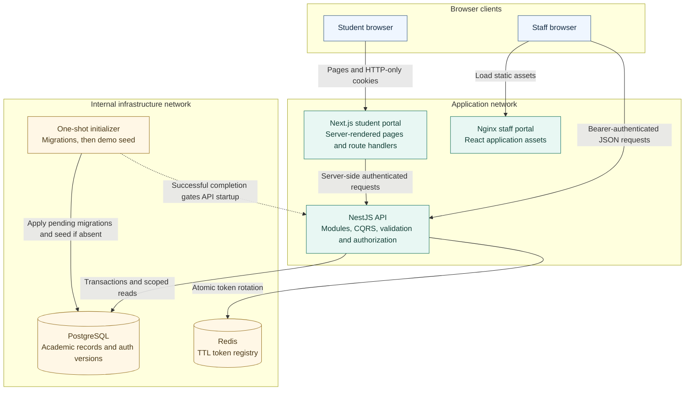

# University Education Management Portal

UEMP manages university course registration, lecturer marks, departmental result approval, and student academic records. It includes a student portal, a privilege-aware staff portal, a NestJS API, and a reproducible local demo with sample accounts and academic data.

Open the hosted [student portal](https://uemp-student.onrender.com/sign-in) or [staff portal](https://uemp-admin.onrender.com/sign-in), or start with the [local setup](#run-the-complete-application), then follow the [reviewer walkthrough](docs/reviewer-guide.md). The [acceptance evidence map](docs/acceptance-criteria.md) links the requirements to screens, implementation, and verification. The [architecture guide](docs/architecture.md), [database design and ERD](docs/database.md), and [security model](docs/security.md) explain the implementation and its tradeoffs.

## Run the complete application

Install Docker with Docker Compose. Host Node.js and database installations are unnecessary for this route. From the repository root, copy the supplied example and start the stack:

```powershell
Copy-Item .env.example .env
docker compose up --build --wait
```

On macOS/Linux, use `cp .env.example .env` for the copy step. Copy the file once when setting up a new checkout. The example already contains working **local demo configuration**; no values need to be edited to try the application. Its shared credentials and signing keys are public demo values; replace them before a remote deployment.

**Docker Compose needs only this root `.env` file.** Do not copy environment files into either frontend app for this startup path. Compose supplies the student server's API/origin settings at runtime and the staff app's public API address as a Docker build argument. Separate frontend `.env.local` files are needed only for [host development with `pnpm dev`](docs/development.md#host-development); that guide provides the copy commands for each app.

| Application    | Local address                                               | Hosted address                                                                     | Access                                                       |
| -------------- | ----------------------------------------------------------- | ---------------------------------------------------------------------------------- | ------------------------------------------------------------ |
| Student portal | [localhost:3001](http://localhost:3001)                     | [uemp-student.onrender.com/sign-in](https://uemp-student.onrender.com/sign-in)     | Student accounts below, or create an account                 |
| Staff portal   | [localhost:3002](http://localhost:3002)                     | [uemp-admin.onrender.com/sign-in](https://uemp-admin.onrender.com/sign-in)         | Lecturer, HOD, or Super Admin account below                  |
| HTTP API       | [localhost:3000](http://localhost:3000)                     | [uemp-backend.onrender.com](https://uemp-backend.onrender.com)                     | Versioned routes under `/v1`; [API guide](backend/README.md) |
| Swagger UI     | [localhost:3000/docs](http://localhost:3000/docs)           | [uemp-backend.onrender.com/docs](https://uemp-backend.onrender.com/docs)           | Username `uemp`, password `uemp` for local and hosted access |
| OpenAPI JSON   | [localhost:3000/docs-json](http://localhost:3000/docs-json) | [uemp-backend.onrender.com/docs-json](https://uemp-backend.onrender.com/docs-json) | Same documentation credentials                               |

The single [docker-compose.yaml](docker-compose.yaml) starts PostgreSQL and Redis, then runs the one-shot `migrate` job. That job waits for PostgreSQL, applies migrations, and seeds the demo. The API starts only after initialization succeeds; both portals wait for API readiness. Expect `migrate` to exit with code `0` and the other five services to become healthy.

Later startups apply pending migrations and preserve existing accounts, passwords, registrations, and marks. The seed uses a transaction, advisory locking, and committed completion markers, so restarting does not duplicate or reset data. Keep the same project name and PostgreSQL volume to retain your work.

```powershell
docker compose ps -a
docker compose logs --tail 100 migrate backend student admin
docker compose down
```

`down` stops the stack while retaining the database. `up --build --wait` rebuilds changed application images and checks readiness. See [configuration, troubleshooting, and operations](docs/development.md) for port changes, native development, and initialization failures. The supplied Compose setup is a local demo; production initialization and deployment considerations are explained in the [architecture guide](docs/architecture.md).

## Deploy the frontends on Render

The API is deployed at [uemp-backend.onrender.com](https://uemp-backend.onrender.com). The [Render Blueprint](render.yaml) defines two free Docker Web Services for the student and staff portals, both using that existing API. The shared frontend Dockerfile selects the correct application through `FRONTEND_APP`.

Follow the [Render deployment guide](docs/render-deployment.md) to push the configuration, create the Blueprint, and add the actual frontend origins to the existing backend's `CORS_ORIGINS`. The guide also provides exact manual-service settings, ports, build-time variables, and verification steps. The student origin is taken from Render's assigned URL so the configuration does not assume an available hostname.

## Demo access and walkthrough

All seven accounts initially use **`12345678`**, the `DEMO_SEED_PASSWORD` in [.env.example](.env.example). This applies to a fresh database. Changing that setting later does not change existing account passwords.

| Email                            | Portal  | What the account demonstrates                                            |
| -------------------------------- | ------- | ------------------------------------------------------------------------ |
| `student@demo.example.test`      | Student | Existing registration, published result, and additional course selection |
| `student-maya@demo.example.test` | Student | Published B grade, GPA/CGPA, and a result awaiting departmental approval |
| `student-theo@demo.example.test` | Student | The same courses as Maya with a different published grade                |
| `student-nora@demo.example.test` | Student | Empty academic history and first course registration                     |
| `lecturer@demo.example.test`     | Staff   | Assigned class lists, roster closure, marks, and submission              |
| `hod@demo.example.test`          | Staff   | Department administration, lecturer provisioning, review, and reports    |
| `super-admin@demo.example.test`  | Staff   | University setup, accounts, roles, reporting, and audit                  |

The [reviewer guide](docs/reviewer-guide.md) describes the six seeded offerings and provides a tour from registration through publication. It also maps the delivered features to their screens, API modules, documentation, and verification coverage.

## Implemented deliverables

| Area                      | Delivered behavior                                                                                                                                                                            |
| ------------------------- | --------------------------------------------------------------------------------------------------------------------------------------------------------------------------------------------- |
| Student experience        | Signup, secure sign-in, editable profile, matriculation and placement, eligible course registration, academic history, approved results, GPA/CGPA, and authenticated print views              |
| Lecturer experience       | Assigned offerings, paginated rosters, permanent registration closure, CA/exam drafts, validation, submission, review feedback, and performance summaries                                     |
| Department administration | Programme curricula, departmental offerings, lecturer assignment/provisioning, student placement and delegated registration, result decisions, and scoped reports                             |
| University administration | Faculties, departments, programmes, sessions, semesters, reference levels, course catalog, accounts/status, custom roles, scoped grants, university reports, and audit                        |
| Technical delivery        | Source code, migration-defined relational schema, [ERD and data dictionary](docs/database.md), generated Swagger contracts, Docker startup, sample data, and automated backend/browser checks |

The [workflow guide](docs/workflows.md) defines eligibility, registration limits, result states, departmental ownership, reporting, and grading. The application focuses on academic administration; payments, accommodation, admissions screening, messaging gateways, and external university integrations are outside its current scope.

## Acceptance Criteria Evidence Mapping

The [acceptance criteria and evaluation evidence](docs/acceptance-criteria.md) maps all ten acceptance criteria, the four role/workflow areas, the required platform modules, and each weighted evaluation area to working screens, API/source locations, and test suites. It also identifies the technical deliverables, the documented grading policy, and the operational limits of this MVP. Use the [reviewer walkthrough](docs/reviewer-guide.md) to exercise that evidence with the supplied accounts.

## Technology stack and rationale

| Technology                                       | Why it is used here                                                                                                                                                                                                                                                                                               |
| ------------------------------------------------ | ----------------------------------------------------------------------------------------------------------------------------------------------------------------------------------------------------------------------------------------------------------------------------------------------------------------- |
| TypeScript and Node.js 24                        | One language across the API and portals reduces translation between contracts. Strict types catch integration mistakes early; runtime validation still checks untrusted input.                                                                                                                                    |
| NestJS 11                                        | Feature modules separate accounts, registration, grading, and reporting. Dependency injection makes repositories, authorization, audit, and infrastructure services explicit and replaceable in tests.                                                                                                            |
| Nest CQRS and RxJS                               | Use-case commands own changes such as enrolling courses or approving a result group; queries own scoped reads. These domain boundaries keep rules close to the operation they protect. An in-process saga reacts to committed account changes to clean up old token families.                                     |
| PostgreSQL 17                                    | Registration, roster closure, marks, and approval need atomic changes to related records. Transactions, foreign keys, uniqueness, row locks, and exact numeric arithmetic protect those rules under concurrent requests.                                                                                          |
| TypeORM 0.3                                      | Entity mapping keeps persistence aligned with TypeScript, and versioned migrations make every database reproducible. Explicit SQL handles sensitive joins, lock ordering, and credit-weighted aggregates.                                                                                                         |
| Redis 7.4                                        | Expiring session identifiers and atomic single-use refresh claims fit TTL-backed storage. It is used only by the backend; PostgreSQL auth versions remain authoritative for revocation.                                                                                                                           |
| Next.js 16 and React 19                          | Server rendering and same-origin route handlers support authenticated student reads while keeping tokens in HTTP-only cookies. Next.js also supports future public student-facing pages that need initial HTML and metadata for discovery; the current portal is marked `noindex`.                                |
| React 19, Vite 7, and React Router               | The private staff workspace needs interactive tables, marks editing, scoped navigation, and unsaved-work protection rather than public search discovery. A client-rendered SPA fits that work; Vite builds the assets and React Router owns navigation. Indexing is controlled explicitly, not by choosing React. |
| pnpm workspaces and Turborepo                    | The two frontend apps share one maintained design system, theme, API contracts, transport, and tooling. Workspace boundaries prevent app internals leaking into packages; task dependencies and caching coordinate checks and builds.                                                                             |
| Tailwind CSS 4, authored CSS, and Source Sans 3  | Semantic tokens and shared components give both portals consistent spacing, type, states, and light/dark themes. Reusing accessible form/table patterns makes responsive behaviour easier to maintain across workflows. The font is self-hosted under its open licence.                                           |
| Nginx                                            | The staff Docker image needs an HTTP server for Vite's compiled assets. Nginx supplies static delivery, caching, compression, health checks, and the SPA fallback for direct route visits. A managed static host could provide those responsibilities instead.                                                    |
| Swagger, DTO classes, and runtime decoders       | DTOs define validated request and serialized response boundaries with examples reviewers can exercise in Swagger. Generated types and frontend response decoders keep consumers aligned with the HTTP contract.                                                                                                   |
| Winston and OpenTelemetry                        | Structured, correlated logs explain requests, denials, and domain changes without exposing credentials or PII. Development/staging use logs; configured production deployments can additionally export traces and metrics.                                                                                        |
| Docker Compose, Playwright, and Node test runner | Compose makes startup, migrations, and initial data repeatable. Real PostgreSQL/Redis tests check transaction and access rules; browser tests exercise the delivered workflows, navigation, and responsive behaviour.                                                                                             |

The [backend manifest](backend/package.json), [frontend workspace manifest](frontend/package.json), and application manifests declare dependencies; their lockfiles pin resolved versions. The [architecture guide](docs/architecture.md) explains why this is a modular monolith, why the portals use different rendering models, and how CQRS and the saga are bounded.

## Architecture



GitHub renders this Mermaid block as a diagram. [Diagram source](docs/diagrams/architecture.mmd) · [Detailed architecture and request flows](docs/architecture.md)

The API owns business rules and access decisions. Next.js forwards authenticated student requests from the server; the staff browser calls the API using a validated tab session. Nginx serves staff assets. Frontend containers join the application network; PostgreSQL and Redis remain on a separate internal network. No frontend receives database credentials or a Redis connection.

Read [architecture and request flows](docs/architecture.md) for module boundaries, transactions, events, logging, startup, deployment, and engineering tradeoffs.

## Database design

The model separates a shared catalog course from its programme curriculum links and departmental semester offerings. Registration saves academic placement and credit units for the term. Result groups own workflow state; enrolled courses hold marks and the awarded band from a pinned grading policy. Historical records therefore survive later placement changes and account redaction.

The [database guide](docs/database.md) contains the **complete ERD**, focused relationship diagrams, every table/property, cardinality and deletion rules, and constraint/index explanations. [Executable migrations](backend/src/core/database/migrations/) are the schema authority; synchronization is disabled.

## Roles, permissions, and security

There are two account types: `student` and `admin`. Lecturer, HOD, and Super Admin are staff role definitions, not additional account types. A staff account can hold several role assignments. Each assignment grants privileges for one department or, when its department is null, university-wide.

The API checks the privilege on the grant that supplies the relevant scope. Teaching additionally requires the offering assignment, and result actions require a compatible workflow state. The portals use these same grants to decide navigation and controls. A lecturer or HOD cannot approve results they taught, entered, or submitted. Only a university-wide assignment of the protected Super Admin system role can bypass that self-approval restriction; it still needs the normal approval privilege and a submitted group.

Students can read only their own academic records and currently approved results. Passwords are hashed with bcrypt; access/refresh tokens rotate and are revocable. Student tokens use HTTP-only cookies; staff credentials are isolated by browser tab. Audit records track administrative activity, and account deletion redacts direct identifiers while retaining academic history.

The [security guide](docs/security.md) explains session expiry/logout, authorization examples, validation/error handling, transactional audit guarantees, redaction, and the boundaries of the local deployment.

## Project structure

```text
backend/
  src/core/             Configuration, database, Redis, logging, telemetry
  src/shared/           HTTP contracts, guards, authorization and audit contracts
  src/modules/          Auth, user, student, admin, academic setup, courses,
                        registration, grading, results and reporting
  src/demo/             Repeatable sample data
  test/                 Unit and real-database integration fixtures
frontend/
  apps/student/         Next.js student routes and feature components
  apps/admin/           React staff routes and privilege-aware workspaces
  packages/             Theme, UI, API contracts, transport and tooling
  e2e/                  Real-backend Playwright workflows
docs/                   Technical guides, walkthrough and diagram sources
docker-compose.yaml     Complete local stack and initialization job
```

The backend and frontend have separate manifests and lockfiles because they are independently built applications. The two web apps form a frontend monorepo so reusable browser contracts and presentation have one owner. [Backend structure and API reference](backend/README.md), [frontend structure](frontend/README.md), and the [design system](frontend/docs/design-system.md) explain those boundaries in detail.

## Development and verification

For host development, use Node.js 24+ and the pinned pnpm version. Copy the web apps' `.env.example` files to `.env.local` only when running those apps outside Docker. [Development instructions](docs/development.md) give the exact commands, environment variables, contract generation, and troubleshooting.

```powershell
npm --prefix backend run typecheck
npm --prefix backend test
pnpm --dir frontend check
```

Live integration and browser suites use disposable databases because they create accounts, close rosters, and change results. The [verification guide](docs/development.md#verification) distinguishes source checks, PostgreSQL/Redis integration, normal browser mode, production-container checks, and real token-expiry checks. The [reviewer guide](docs/reviewer-guide.md#verification-evidence) explains what those checks establish and the recorded execution limits.
