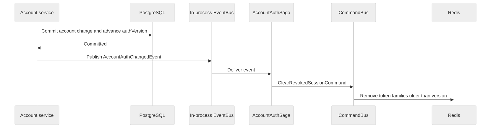

# Architecture

UEMP has a Next.js student portal, a React staff portal and one NestJS API. The API owns accounts, permissions, academic setup, registration, marks, result review and reporting. PostgreSQL is the authoritative store for both academic records and account revocation. Redis holds expiring token-family records and authentication rate counters.

The backend is a modular monolith. Commands, queries and events run within the same Node.js process, and commands and queries use the same PostgreSQL database. This keeps registration and publication in ordinary database transactions while giving each feature an explicit application interface.

See the [project overview](../README.md) for the system diagram, [database guide](database.md) for entities and constraints, [workflows](workflows.md) for business rules, and [security guide](security.md) for trust boundaries and sessions.

## Runtime and technology choices

| Part                     | Implementation and purpose                                                                                                                                          |
| ------------------------ | ------------------------------------------------------------------------------------------------------------------------------------------------------------------- |
| API                      | NestJS 11 on the Express adapter, with URI-versioned JSON routes under `/v1`. Liveness and readiness remain unversioned.                                            |
| Language                 | Strict TypeScript, NodeNext modules and explicit `.js` import suffixes. The package supports Node.js 22 or newer; the Docker image uses Node.js 24.                 |
| Application dispatch     | Nest CQRS command/query buses separate write operations from read projections and provide a common instrumentation boundary.                                        |
| Persistence              | TypeORM 0.3 with PostgreSQL 17, explicit migrations and `synchronize: false`. Relations, uniqueness checks and triggers enforce invariants beyond HTTP validation.  |
| Short-lived coordination | Redis 7.4 and ioredis provide atomic refresh claims, token-family updates and authentication rate counters.                                                         |
| HTTP contracts           | DTO classes, class-validator, class-transformer and generated Swagger/OpenAPI documentation. The same response DTO controls serialization and the published schema. |
| Operations               | Winston structured logs, request correlation, dependency health checks and optional production OpenTelemetry metrics/traces.                                        |

The student portal acts as a server-side HTTP client: its route handlers own authentication cookies and its server components fetch student records from Nest. The staff portal is a browser client that sends bearer tokens directly to the configured API origin. Neither frontend connects to PostgreSQL or Redis.

## Source boundaries

| Location              | Responsibility                                                                                                                                                         |
| --------------------- | ---------------------------------------------------------------------------------------------------------------------------------------------------------------------- |
| `backend/src/core`    | Environment loading, database configuration/migrations, Redis lifecycle, logging, telemetry and health checks. Infrastructure does not import feature implementations. |
| `backend/src/shared`  | Cross-feature commands/queries/events, account and privilege contracts, guards, public error handling, DTO serialization and common HTTP helpers.                      |
| `backend/src/modules` | Feature controllers, DTOs, command/query handlers, services, repositories and entities.                                                                                |
| `backend/src/demo`    | Repeatable synthetic accounts and academic fixtures for the local demonstration.                                                                                       |
| `backend/test`        | Node test suites and opt-in integration fixtures.                                                                                                                      |

Feature ownership follows the domain:

| Module               | Owns                                                                                                                                             |
| -------------------- | ------------------------------------------------------------------------------------------------------------------------------------------------ |
| `auth`               | Sign-in, token issuance/rotation, registry access, sign-out, rate limiting and post-commit token cleanup.                                        |
| `user`               | Account/profile lifecycle, student placement, matriculation issuance and redaction.                                                              |
| `student`            | Student and matriculation entities.                                                                                                              |
| `admin`              | Staff profiles, roles, scoped grants, delegation and administrator audit history.                                                                |
| `academic-reference` | Faculties, departments, programmes, levels, academic sessions, semesters and active public signup choices.                                       |
| `course`             | Shared catalogue courses, programme curriculum links, department offerings and lecturer assignment.                                              |
| `registration`       | Student term snapshots, eligibility, enrollment, teaching rosters and permanent roster closure.                                                  |
| `grading`            | Versioned grading policy and grade-band entities. The initial policy is installed by migrations; there is no grading-policy management HTTP API. |
| `results`            | Draft marks, submission, correction requests, approval, reopening and published student statements/GPA.                                          |
| `reporting`          | Authorized department/university academic aggregates and course performance reports.                                                             |

Controllers translate HTTP DTOs into commands or queries. Handlers delegate to the owning service; services enforce the business rule and transaction boundary. Cross-feature operations use contracts rather than importing another feature's service. A service that owns a database invariant can access the related tables through the same transaction manager.

## Request lifecycle

1. Startup loads the root `.env` without replacing values already supplied by the process or container. Telemetry is initialized before importing the HTTP application.
2. HTTP middleware generates a request ID, establishes request context, applies security headers and records the eventual response outcome. Configured CORS origins are exact allowed browser origins.
3. Protected routes validate the bearer token, active account, account auth version and registered token family. Staff routes additionally check administrator access and any declared capability. Resource-level department and assignment checks happen in the service using the validated request.
4. The global validation pipe transforms DTO inputs, rejects unknown fields and returns explicit validation messages. The controller dispatches a command or query.
5. The service reads an authorized projection or completes a transaction. Response DTO serialization exposes the documented field allowlist. A global exception filter maps expected failures to useful public messages and masks unexpected internal errors.

Protected responses and token-bearing responses use `Cache-Control: no-store`. Profile reads resolve a student's assigned placement labels even after a reference is deactivated; the public signup lookup continues to return active choices only.

The main entry points are [bootstrap](../backend/src/bootstrap.ts), [access authentication](../backend/src/shared/auth/access-token.guard.ts), [staff authorization](../backend/src/shared/admin-authorization/admin-privilege.guard.ts) and [response serialization](../backend/src/shared/http/api-dto-response.decorator.ts).

## Transactions and consistent reads

Registration locks the student account before selecting or creating the term snapshot. It locks selected offerings in ID order, then their result groups, before checking eligibility, duplicate courses, credit limits and roster closure. Offering reassignment, roster closure and result changes use the same offering-before-group order. Concurrent writers therefore serialize around the academic records they can change.

Marks, state transitions, grade awards and their successful audit events commit together. Approval requires complete marks on a submitted group and awards bands from the offering's pinned policy. Reopening clears current awards and withdraws student publication in the same transaction; it never reopens registration. PostgreSQL triggers also reject invalid transitions, changes to locked marks, inconsistent enrollments and changes to retained academic identity.

Directories, multi-query summaries, review views and statements use repeatable-read snapshots where their result must remain consistent across queries. GPA/CGPA queries include only currently approved awards and keep PostgreSQL numeric precision until final rounding. A read model is SQL/DTO projection, not a separately replicated store.

Database writes use `databaseWrite` or `writeTransaction`, including commit-time constraint failures. Conflicts and invalid references become public conflict/input messages rather than raw SQL or driver details. See [database constraints](database.md) and [workflow transitions](workflows.md) for the complete rules.

## Events and the account cleanup saga

There is one actual Nest `@Saga()`: [AccountAuthSaga](../backend/src/modules/auth/sagas/account-auth.saga.ts). After an account lifecycle transaction advances `authVersion`, the user service publishes `AccountAuthChangedEvent`. The saga turns that event into `ClearRevokedSessionCommand`, whose handler removes older token families from Redis.

[Editable Mermaid source](diagrams/account-session-saga.mmd)

This is local event-to-command orchestration. It has no durable message broker, outbox, replay log or compensating distributed transaction. PostgreSQL version checks already reject revoked tokens even if the process stops before Redis cleanup; expired registry entries also have TTLs. A delayed cleanup uses the event's version and cannot delete a newer sign-in. Asynchronous handler failures are logged through the CQRS exception bus.

CQRS is used for explicit ownership and consistent instrumentation, rather than event sourcing. Administrator audit rows are retained evidence; application state is stored in the normal relational tables and is not reconstructed from audit events.

## Audit and observability

Administrator HTTP mutations declare semantic audit actions. The guard records recognized privilege denials; the interceptor records other denied, failed or successful attempts. Result changes, roster closure and offering reassignment write success events inside their owning transaction. Their interceptor metadata prevents duplicate success events. Other mutation audits occur separately after the operation; an audit persistence failure is logged without misreporting an already committed mutation as rolled back.

Logs contain safe action/type names, internal IDs, duration, outcome and correlation IDs. They omit request bodies, credentials, raw query strings and personal identifiers. Request IDs are generated at the API boundary and returned as `x-request-id`; an active trace adds `x-trace-id`.

Command/query execution is wrapped once to record duration, message type and outcome. Development, staging and test use structured logs without telemetry exporters. In production, `OTEL_EXPORTER_OTLP_ENDPOINT` enables the OpenTelemetry SDK for metrics/traces. File-system and Redis auto-instrumentation are disabled and enhanced PostgreSQL reporting is off. The repository does not include a collector or observability dashboard.

## Startup, deployment and limits

The single root Compose definition starts PostgreSQL, Redis, a one-shot initialization job, the API and both portals. The initialization job waits for a usable PostgreSQL connection, applies pending migrations, then runs the transactional demo seed. Durable completion markers and an advisory transaction lock keep repeated/concurrent seed runs from duplicating or resetting data. The HTTP server does not run migrations itself.

The API joins the application and internal infrastructure networks. Portals join only the application network; database/cache services publish no host ports. API and portal host ports bind to loopback in the provided stack. Readiness probes both PostgreSQL and Redis; liveness reports that the API process can answer. Shutdown closes the Nest application and optional telemetry SDK.

The supplied Compose startup is intended for development and demonstration: its initializer always checks the demo seed, which rejects production and databases outside the demo/test naming convention. A production deployment must run migrations without demo seeding and provide its own deployment configuration, TLS termination, secret management and backup/restore process. [Development](development.md) documents supported local commands and configuration.

The design intentionally makes protected access depend on PostgreSQL and Redis. Redis loss ends stored sessions and authentication fails closed while it is unavailable. Post-commit cleanup is not a durable background job, and routine mutation audit delivery outside the transaction is not guaranteed during audit-store failure. These limits are explicit so availability and retention choices can be evaluated independently from the academic transaction guarantees.
