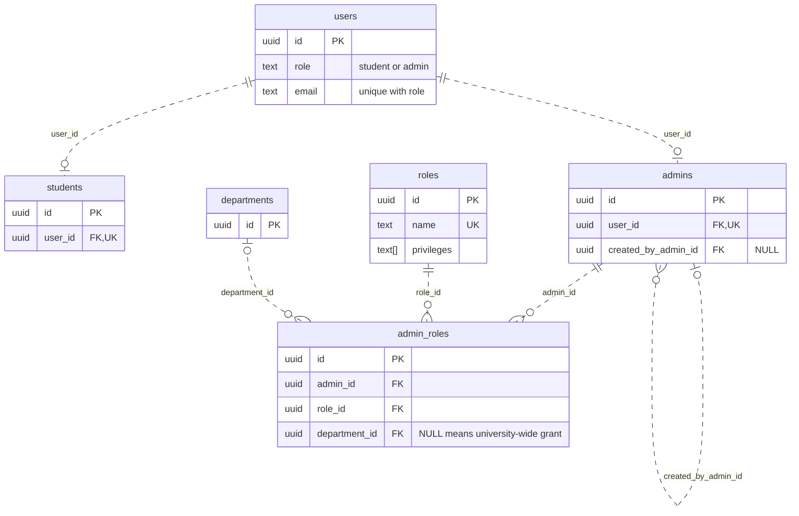
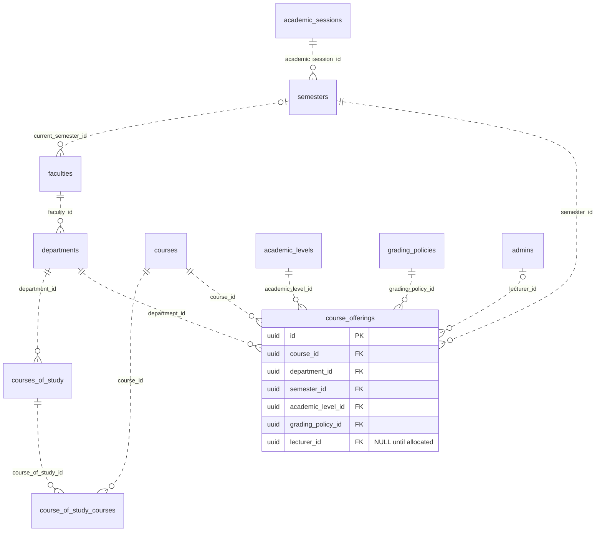
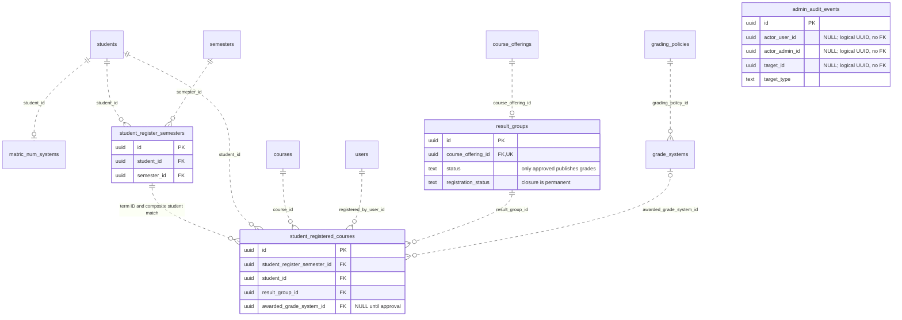

# Database design

PostgreSQL stores accounts, academic placement, departmental course delivery, registration, grading, and audit history. The model separates a shared catalog course from each department's offering so programmes can reuse course definitions without sharing another department's roster or approval authority. Self-approval is reserved for a university-wide protected Super Admin grant together with the normal approval privilege; departmental approval alone does not permit it.

The physical schema is defined by the [timestamped migrations](../backend/src/core/database/migrations/) and mirrored by the [TypeORM entities](../backend/src/modules/). Automatic ORM synchronization is disabled in [database configuration](../backend/src/core/database/ormconfig.ts); the initialization job applies migrations before the API starts. PostgreSQL 17 is the Compose database version.

## Complete entity relationship diagram

The focused views below render directly in GitHub Markdown. The complete physical schema is available in the expandable diagram; the `.mmd` files remain the editable sources.

```mermaid
%% Complete physical PostgreSQL schema. All attributes are NOT NULL unless marked NULL.
%% PK = primary key; FK = enforced foreign key; UK = single-column unique constraint.
%% Composite/expression/partial unique constraints are documented in database.md.
%% Dashed lines are non-identifying FK relationships; every domain table uses a surrogate UUID PK.
%% Audit actor/target UUIDs are logical identifiers, deliberately not FK relationships.
erDiagram
    direction LR
    users {
        uuid id PK
        timestamptz created_at "default now()"
        timestamptz updated_at "default now()"
        text first_name "NULL"
        text last_name "NULL"
        text role
        text email
        text hashed_password "NULL"
        integer auth_version "default 0"
        timestamptz deleted_at "NULL"
        text status "default 'active'"
    }
    academic_levels {
        uuid id PK
        timestamptz created_at "default now()"
        timestamptz updated_at "default now()"
        text program_type
        smallint stage
        varchar display_name "varchar(100)"
        text status "default 'active'"
    }
    academic_sessions {
        uuid id PK
        timestamptz created_at "default now()"
        timestamptz updated_at "default now()"
        smallint start_year
        smallint end_year
        text status "default 'inactive'"
    }
    semesters {
        uuid id PK
        timestamptz created_at "default now()"
        timestamptz updated_at "default now()"
        uuid academic_session_id FK
        smallint term_number
        text name
        smallint max_units
        text status "default 'inactive'"
    }
    faculties {
        uuid id PK
        timestamptz created_at "default now()"
        timestamptz updated_at "default now()"
        text name
        text status "default 'active'"
        uuid current_semester_id FK "NULL"
        integer short_id UK "identity; default AS IDENTITY NOT NULL"
    }
    departments {
        uuid id PK
        timestamptz created_at "default now()"
        timestamptz updated_at "default now()"
        uuid faculty_id FK
        text name
        text status "default 'active'"
        integer short_id UK "identity; default AS IDENTITY NOT NULL"
    }
    courses_of_study {
        uuid id PK
        timestamptz created_at "default now()"
        timestamptz updated_at "default now()"
        uuid department_id FK
        text name
        text program_type
        text status "default 'active'"
        integer short_id UK "identity; default AS IDENTITY NOT NULL"
    }
    students {
        uuid id PK
        timestamptz created_at "default now()"
        timestamptz updated_at "default now()"
        uuid user_id FK,UK
        uuid academic_level_id FK "NULL"
        uuid course_of_study_id FK "NULL"
        uuid department_id FK "NULL"
        uuid faculty_id FK "NULL"
    }
    matric_num_systems {
        uuid id PK
        timestamptz created_at "default now()"
        uuid student_id FK,UK
        uuid faculty_id FK
        uuid department_id FK
        uuid course_of_study_id FK
        smallint issued_year
        integer short_id UK "identity; default AS IDENTITY NOT NULL"
        text matric_number UK
    }
    admins {
        uuid id PK
        timestamptz created_at "default now()"
        timestamptz updated_at "default now()"
        uuid user_id FK,UK
        uuid created_by_admin_id FK "NULL"
    }
    roles {
        uuid id PK
        timestamptz created_at "default now()"
        timestamptz updated_at "default now()"
        text name UK
        text description "NULL"
        text kind
        text system_key UK "NULL"
        uuid created_by_admin_id FK "NULL"
        text[] privileges "default '{}'::text[]"
    }
    admin_roles {
        uuid id PK
        timestamptz created_at "default now()"
        uuid admin_id FK
        uuid role_id FK
        uuid assigned_by_admin_id FK "NULL"
        uuid department_id FK "NULL"
    }
    courses {
        uuid id PK
        timestamptz created_at "default now()"
        timestamptz updated_at "default now()"
        text name
        text code UK
        smallint units
        text status "default 'active'"
    }
    course_of_study_courses {
        uuid id PK
        timestamptz created_at "default now()"
        uuid course_of_study_id FK
        uuid course_id FK
    }
    grading_policies {
        uuid id PK
        timestamptz created_at "default now()"
        timestamptz updated_at "default now()"
        integer version UK
        text name
        numeric max_ca_score "numeric(5,2)"
        numeric max_exam_score "numeric(5,2)"
        text status "default 'draft'"
    }
    grade_systems {
        uuid id PK
        timestamptz created_at "default now()"
        timestamptz updated_at "default now()"
        uuid grading_policy_id FK
        text grade
        numeric min_score "numeric(5,2)"
        numeric max_score "numeric(5,2)"
        numeric point "numeric(5,2)"
    }
    course_offerings {
        uuid id PK
        timestamptz created_at "default now()"
        timestamptz updated_at "default now()"
        uuid course_id FK
        uuid department_id FK
        uuid semester_id FK
        uuid academic_level_id FK
        uuid lecturer_id FK "NULL"
        smallint units
        uuid grading_policy_id FK
        text status "default 'inactive'"
    }
    student_register_semesters {
        uuid id PK
        timestamptz created_at "default now()"
        timestamptz updated_at "default now()"
        uuid student_id FK
        uuid semester_id FK
        uuid academic_level_id FK
        uuid course_of_study_id FK
        uuid department_id FK
        uuid faculty_id FK
    }
    result_groups {
        uuid id PK
        timestamptz created_at "default now()"
        timestamptz updated_at "default now()"
        uuid course_offering_id FK,UK
        uuid lecturer_id FK
        text status "default 'pending'"
        text registration_status "default 'opened'"
        timestamptz registration_closed_at "NULL"
        uuid registration_closed_by_admin_id FK "NULL"
        timestamptz submitted_at "NULL"
        uuid submitted_by_admin_id FK "NULL"
        text submission_reason "NULL"
        timestamptz approved_at "NULL"
        uuid approved_by_admin_id FK "NULL"
        text approval_reason "NULL"
        timestamptz correction_requested_at "NULL"
        uuid correction_requested_by_admin_id FK "NULL"
        text correction_request_reason "NULL"
    }
    student_registered_courses {
        uuid id PK
        timestamptz created_at "default now()"
        timestamptz updated_at "default now()"
        uuid student_id FK
        uuid course_id FK
        uuid student_register_semester_id FK
        uuid result_group_id FK
        uuid registered_by_user_id FK
        smallint registered_units
        numeric ca_score "NULL; numeric(5,2)"
        numeric exam_score "NULL; numeric(5,2)"
        uuid awarded_grade_system_id FK "NULL"
    }
    admin_audit_events {
        uuid id PK
        text action
        text category
        uuid actor_user_id "NULL; logical UUID; no FK"
        uuid actor_admin_id "NULL; logical UUID; no FK"
        text target_type
        uuid target_id "NULL; logical UUID; no FK"
        text outcome
        text reason "NULL"
        jsonb changes "NULL"
        jsonb metadata "NULL"
        text request_id "NULL"
        text trace_id "NULL"
        timestamptz occurred_at "default now()"
    }
    migrations {
        integer id PK "generated increment; infrastructure ledger"
        bigint timestamp "migration class timestamp"
        varchar name "migration class name"
    }

    academic_sessions ||..o{ semesters : "academic_session_id; RESTRICT"
    semesters |o..o{ faculties : "current_semester_id; RESTRICT"
    faculties ||..o{ departments : "faculty_id; CASCADE"
    departments ||..o{ courses_of_study : "department_id; RESTRICT"
    users ||..o| students : "user_id; RESTRICT"
    academic_levels |o..o{ students : "academic_level_id; SET NULL"
    courses_of_study |o..o{ students : "course_of_study_id; SET NULL"
    departments |o..o{ students : "department_id; SET NULL"
    faculties |o..o{ students : "faculty_id; SET NULL"
    students ||..o| matric_num_systems : "student_id; RESTRICT"
    faculties ||..o{ matric_num_systems : "faculty_id; RESTRICT"
    departments ||..o{ matric_num_systems : "department_id; RESTRICT"
    courses_of_study ||..o{ matric_num_systems : "course_of_study_id; RESTRICT"
    users ||..o| admins : "user_id; RESTRICT"
    admins |o..o{ admins : "created_by_admin_id; SET NULL"
    admins |o..o{ roles : "created_by_admin_id; SET NULL"
    admins ||..o{ admin_roles : "admin_id; CASCADE"
    roles ||..o{ admin_roles : "role_id; CASCADE"
    admins |o..o{ admin_roles : "assigned_by_admin_id; SET NULL"
    departments |o..o{ admin_roles : "department_id; RESTRICT"
    courses_of_study ||..o{ course_of_study_courses : "course_of_study_id; RESTRICT"
    courses ||..o{ course_of_study_courses : "course_id; RESTRICT"
    grading_policies ||..o{ grade_systems : "grading_policy_id; RESTRICT"
    courses ||..o{ course_offerings : "course_id; RESTRICT"
    departments ||..o{ course_offerings : "department_id; RESTRICT"
    semesters ||..o{ course_offerings : "semester_id; RESTRICT"
    academic_levels ||..o{ course_offerings : "academic_level_id; RESTRICT"
    admins |o..o{ course_offerings : "lecturer_id; RESTRICT"
    grading_policies ||..o{ course_offerings : "grading_policy_id; RESTRICT"
    students ||..o{ student_register_semesters : "student_id; RESTRICT"
    semesters ||..o{ student_register_semesters : "semester_id; RESTRICT"
    academic_levels ||..o{ student_register_semesters : "academic_level_id; RESTRICT"
    courses_of_study ||..o{ student_register_semesters : "course_of_study_id; RESTRICT"
    departments ||..o{ student_register_semesters : "department_id; RESTRICT"
    faculties ||..o{ student_register_semesters : "faculty_id; RESTRICT"
    course_offerings ||..o| result_groups : "course_offering_id; RESTRICT"
    admins ||..o{ result_groups : "lecturer_id; RESTRICT"
    admins |o..o{ result_groups : "registration_closed_by_admin_id; RESTRICT"
    admins |o..o{ result_groups : "submitted_by_admin_id; RESTRICT"
    admins |o..o{ result_groups : "approved_by_admin_id; RESTRICT"
    admins |o..o{ result_groups : "correction_requested_by_admin_id; RESTRICT"
    students ||..o{ student_registered_courses : "student_id; RESTRICT"
    courses ||..o{ student_registered_courses : "course_id; RESTRICT"
    student_register_semesters ||..o{ student_registered_courses : "student_register_semester_id; RESTRICT"
    result_groups ||..o{ student_registered_courses : "result_group_id; RESTRICT"
    users ||..o{ student_registered_courses : "registered_by_user_id; RESTRICT"
    grade_systems |o..o{ student_registered_courses : "awarded_grade_system_id; RESTRICT"
    student_register_semesters ||..o{ student_registered_courses : "composite student_register_semester_id, student_id; RESTRICT"
```

Expand the complete physical schema: all 22 tables and 185 columns

[Complete Mermaid source](diagrams/database.mmd)

The complete diagram includes **21 domain tables, the TypeORM migration ledger, 185 columns, and all 48 foreign key constraints**. The focused diagrams below omit non-key fields and some secondary actor references for readability; the full diagram and foreign key inventory are exhaustive.

- `PK` marks a primary key; `FK` marks an enforced foreign key; `UK` marks a single-column unique constraint. Composite, partial, and expression uniqueness is described below rather than implying that each participating column is individually unique.
- Attributes are `NOT NULL` unless their diagram comment says `NULL`. A nullable relationship has zero or one parent; a required foreign key has exactly one parent. Parents may have zero children. One-to-one uniqueness limits a child collection to zero or one.
- Dashed lines use Mermaid's non-identifying relationship notation: child tables have their own surrogate primary keys. They still represent enforced foreign keys. Relationship labels give the child columns and `ON DELETE` action.
- `admin_audit_events.actor_user_id`, `actor_admin_id`, and `target_id` are nullable **logical UUID values, not foreign keys**. Audit events are deliberately unconnected in the physical ERD. `target_type` identifies the resource kind; a target need not exist or be resolved when an attempt fails.
- The `migrations` ledger is infrastructure metadata, not a domain entity. Redis token records are not PostgreSQL tables.

### Identity and access

[Editable Mermaid source](diagrams/database-identity.mmd)

The database allows zero or one profile of each kind per user; account creation writes exactly the matching profile in its transaction, and a trigger rejects a profile with the wrong account type. A grant's nullable department controls only that grant. A teaching privilege in one department cannot combine with a grading privilege in another to authorize either department's marks.

### Academic catalog and departmental delivery

[Editable Mermaid source](diagrams/database-academics.mmd)

`course_of_study_courses` resolves the programme/catalog many-to-many relation. An offering belongs to one department, term and level. Programmes in that department can share the offering; programmes in different departments use separate offerings. Pinning its units and grading policy prevents later catalog or grading changes from rewriting registered history.

### Registration, publication and retained history

[Editable Mermaid source](diagrams/database-results.mmd)

Term records freeze the student's placement. Enrollment records freeze the registered credit units, course and actor. A result group owns roster closure and publication for one offering. Audit UUIDs correlate these operations without requiring a live relational target or mutable profile details.

## Naming and common fields

PostgreSQL uses `snake_case` for tables, columns, and named constraints. NestJS uses singular entity names and `camelCase` properties. The field tables below use NestJS property names. An unmarked field is required. “Optional” means the column is nullable. “Reference” means a UUID foreign key to the named entity.

Text fields are PostgreSQL `text` except `AcademicLevel.displayName` (`varchar(100)`). Score, band, point and component-limit decimals use `numeric(5,2)`; year, stage, term-number and unit fields use `smallint`; auth versions, policy versions and generated short IDs use `integer`. Audit objects use `jsonb`, privileges use `text[]`, and all date/time fields use `timestamptz`. The full ERD shows physical column types and defaults.

| Property    | Type and default                          | Comment                                                                                            |
| ----------- | ----------------------------------------- | -------------------------------------------------------------------------------------------------- |
| `id`        | UUIDv7, primary key                       | Gives each record a stable ID generated by the application.                                        |
| `createdAt` | Timestamp with time zone, defaults to now | Records when the row was created. For a matriculation record, this is also the issuance timestamp. |
| `updatedAt` | Timestamp with time zone, defaults to now | Records the most recent edit to a mutable row.                                                     |

Every domain entity has `id`. Mutable entities have both timestamps. `AdminRole`, `CourseOfStudyCourse`, and `MatricNumSystem` have `createdAt` only. `AdminAuditEvent` uses `occurredAt` for its event time. The application generates UUIDv7 values; PostgreSQL does not supply an ID default. `createdAt` defaults to `now()` in PostgreSQL; TypeORM maintains `updatedAt` on its writes. The separate migration ledger uses an incrementing integer key.

## Accounts and privileges

### User

PostgreSQL table `users`.

| Property         | Type and default                              | Comment                                                                                                                                            |
| ---------------- | --------------------------------------------- | -------------------------------------------------------------------------------------------------------------------------------------------------- |
| `firstName`      | Text, optional                                | Stores the given name used on the user’s profile and in display names.                                                                             |
| `lastName`       | Text, optional                                | Stores the family name used on the user’s profile and in display names.                                                                            |
| `role`           | `student` or `admin`                          | Identifies the account type used to sign in and selects the corresponding profile.                                                                 |
| `email`          | Text                                          | Stores the trimmed, lowercase login address. It is unique within an account type. On deletion, a unique placeholder replaces the original address. |
| `hashedPassword` | Text, nullable for deleted accounts           | Stores the password hash used to verify sign-in. Account deletion clears it. API responses, logs, and audit records exclude it.                    |
| `authVersion`    | Nonnegative integer, defaults to `0`          | Identifies the current token family. Issuance, rotation, and account revocation advance it so older tokens fail validation.                        |
| `deletedAt`      | Timestamp with time zone, optional            | Records when account access ended and its identity was redacted. The internal ID remains available to academic and audit records.                  |
| `status`         | `active` or `suspended`, defaults to `active` | Controls whether the account can authenticate and continue an existing session.                                                                    |

The `(email, role)` unique constraint gives each account type its own login identity. A deleted row retains its placeholder address, so its former address can be registered again within the same account type. Account creation writes the matching profile in the same transaction. The account type is fixed after creation. Sign-in identifies the account type and rejects suspended or deleted users. Changing the password, suspending the account, or deleting it invalidates the active session.

### Student

PostgreSQL table `students`.

| Property          | Type and default                                            | Comment                                                                                                                                  |
| ----------------- | ----------------------------------------------------------- | ---------------------------------------------------------------------------------------------------------------------------------------- |
| `userId`          | Reference to User, unique                                   | Connects the academic profile to exactly one Student account.                                                                            |
| `academicLevelId` | Reference to AcademicLevel, optional, sets null on deletion | Holds the current level. A student can choose a valid level during signup. Later changes require an authorized admin.                    |
| `courseOfStudyId` | Reference to CourseOfStudy, optional, sets null on deletion | Identifies the student’s programme. Its course links define which catalog courses the student can take.                                  |
| `departmentId`    | Reference to Department, optional, sets null on deletion    | Records the current department for administration and access checks. It also supports placement before a programme is chosen.            |
| `facultyId`       | Reference to Faculty, optional, sets null on deletion       | Records the current faculty and identifies its selected registration semester. It also supports placement before a department is chosen. |

The one-to-one `matricNumSys` relation is populated from `MatricNumSystem.studentId`. The placement handler validates each change as a single operation. A selected programme must belong to the selected department, the department must belong to the selected faculty, and the level’s programme type must match the programme’s type when both are set. Registration requires a complete, active placement and an issued matriculation number. Placement changes affect future eligibility. Semester records preserve their original context. The matriculation number survives placement changes and is removed on account deletion.

### Admin

PostgreSQL table `admins`.

| Property           | Type and default                                    | Comment                                                                                           |
| ------------------ | --------------------------------------------------- | ------------------------------------------------------------------------------------------------- |
| `userId`           | Reference to User, unique                           | Connects the administrative profile to exactly one Admin account.                                 |
| `createdByAdminId` | Reference to Admin, optional, sets null on deletion | Identifies the admin who created this account. The bootstrap account can start without a creator. |

The `adminRoles` collection comes from `AdminRole.adminId`. Role changes keep the same Admin ID, so a lecturer can become HOD and continue to own the relevant teaching and audit records.

### Role

PostgreSQL table `roles`.

| Property           | Type and default                                               | Comment                                                                                                                                                                           |
| ------------------ | -------------------------------------------------------------- | --------------------------------------------------------------------------------------------------------------------------------------------------------------------------------- |
| `name`             | Text, lowercase slug of at most 80 characters, unique          | Names the role, such as `hod`, `lecturer`, or `ict-manager`. Slugs contain alphanumeric words separated by single hyphens. Admin assignments read this name from the linked role. |
| `description`      | Text, optional                                                 | Explains what the role is for when an administrator reviews or assigns it.                                                                                                        |
| `kind`             | `custom` or `system`                                           | Distinguishes administrator-defined roles from the roles seeded by the application.                                                                                               |
| `systemKey`        | `super_admin`, `hod`, or `lecturer`, optional, unique when set | Gives each seeded role a stable identifier independent of its display name. A system role requires a key and a custom role has none.                                              |
| `createdByAdminId` | Reference to Admin, optional, sets null on deletion            | Records the author of a custom role. Seeded roles have no creating admin.                                                                                                         |
| `privileges`       | Text array, defaults to empty                                  | Lists capabilities such as `read_user`, `grade_result`, and `approve_result`. Values must come from the privilege catalog.                                                        |

The `adminRoles` collection comes from `AdminRole.roleId`. System keys and the capabilities of seeded roles are maintained by the application. Custom roles can combine capabilities without introducing a new user account type.

### AdminRole

PostgreSQL table `admin_roles`. Each row grants a named role to an admin, optionally within one department. The linked role supplies the name through `roleId`.

| Property            | Type and default                                                     | Comment                                                                                                                    |
| ------------------- | -------------------------------------------------------------------- | -------------------------------------------------------------------------------------------------------------------------- |
| `adminId`           | Reference to Admin, cascades on deletion                             | Identifies the administrator receiving the role.                                                                           |
| `roleId`            | Reference to Role, cascades on deletion                              | Identifies the role whose privileges the assignment grants.                                                                |
| `assignedByAdminId` | Reference to Admin, optional, sets null on deletion                  | Identifies the admin who granted the role. Bootstrap assignments may have no assigner.                                     |
| `departmentId`      | Reference to Department, optional, restricts deletion while assigned | Limits every privilege from this grant to one department. A null value leaves this grant without a department restriction. |

Partial unique indexes allow the same role in different departments while preventing duplicate global or departmental grants. Authorization matches each requested privilege to the scope of the grant that supplies it. Delegation stays within the assigner’s privileges and scope; a scoped HOD can provision the seeded Lecturer grant in that department during account creation. The bootstrap Super Admin grant is university-wide. Scope changes revoke the old grant and create a new one.

## Academic structure and terms

### AcademicLevel

PostgreSQL table `academic_levels`.

| Property      | Type and default                                   | Comment                                                                                                                  |
| ------------- | -------------------------------------------------- | ------------------------------------------------------------------------------------------------------------------------ |
| `programType` | `undergrad`, `postgrad`, `masters`, or `doctorate` | Identifies the university programme family. It must match the selected programme’s type.                                 |
| `stage`       | Integer from 0 to 6                                | Records progression within the programme. Positive values are stages of study. Stage 0 records graduation.               |
| `displayName` | Text, up to 100 characters                         | Supplies the label shown in selectors and reports. Examples are `100 Level`, `Masters`, and `Graduate`.                  |
| `status`      | `active` or `inactive`, defaults to `active`       | Controls whether this level can be selected for placement. Offerings and registrations require an active positive stage. |

The `(programType, stage)` pair is unique. The entity mapping fixes the programme family and stage after creation. Historical registrations retain their level reference after deactivation.

| Programme family | Seeded stages and display names                 |
| ---------------- | ----------------------------------------------- |
| `undergrad`      | Stages 1–6 use `100 Level` through `600 Level`. |
| `postgrad`       | Stage 1 uses `Postgraduate`.                    |
| `masters`        | Stage 1 uses `Masters`.                         |
| `doctorate`      | Stage 1 uses `Doctorate`.                       |

Each family has its own stage 0 row named `Graduate`; the programme family distinguishes these rows. Signup accepts active positive study stages. An authorized admin can assign the Graduate stage when updating an existing placement.

### AcademicSession

PostgreSQL table `academic_sessions`. The display label is derived from the year pair, such as `2026/2027`.

| Property    | Type and default                               | Comment                                                                                                      |
| ----------- | ---------------------------------------------- | ------------------------------------------------------------------------------------------------------------ |
| `startYear` | Four-digit integer                             | Records the first calendar year of the academic session and gives sessions a chronological sort key.         |
| `endYear`   | Four-digit integer                             | Records the final calendar year of the session. It must be at least `startYear`.                             |
| `status`    | `active` or `inactive`, defaults to `inactive` | Controls whether the session is available for current academic operations. Historical records remain linked. |

The `(startYear, endYear)` pair is unique. A session can contain multiple semesters. Faculties choose their current semester independently.

### Semester

PostgreSQL table `semesters`.

| Property            | Type and default                               | Comment                                                                                                                            |
| ------------------- | ---------------------------------------------- | ---------------------------------------------------------------------------------------------------------------------------------- |
| `academicSessionId` | Reference to AcademicSession                   | Groups this semester with the other terms in the same academic year.                                                               |
| `termNumber`        | Positive small integer                         | Orders terms within a session and gives each term an identity independent of its display name.                                     |
| `name`              | Text                                           | Displays the semester name, such as “First Semester”.                                                                              |
| `maxUnits`          | Positive small integer                         | Caps the total units a student can register for in this semester. Changes apply when checking later registrations.                 |
| `status`            | `active` or `inactive`, defaults to `inactive` | Controls whether the term is eligible for new registrations. Old registrations and results remain available to authorized readers. |

The `(academicSessionId, termNumber)` pair is unique. New registrations require an active session and semester and the semester must match the student’s faculty’s current selection. Lowering the unit limit leaves existing enrollments in place and applies the new limit to additional registrations.

### Faculty

PostgreSQL table `faculties`.

| Property            | Type and default                                       | Comment                                                                                                             |
| ------------------- | ------------------------------------------------------ | ------------------------------------------------------------------------------------------------------------------- |
| `name`              | Text, unique after case normalization                  | Names the faculty in the academic hierarchy and university reports.                                                 |
| `status`            | `active` or `inactive`, defaults to `active`           | Controls whether the faculty can be used in new placements and registrations.                                       |
| `currentSemesterId` | Reference to Semester, optional                        | Selects the term open for registration in this faculty. A faculty can exist before it selects a term.               |
| `shortId`           | Positive database-generated integer, unique, immutable | Supplies the faculty segment of a matriculation number. The public number remains stable if the faculty is renamed. |

Only an active semester in an active session can be selected as current. Registration checks current status again at the time of enrollment.

### Department

PostgreSQL table `departments`.

| Property    | Type and default                                       | Comment                                                                                      |
| ----------- | ------------------------------------------------------ | -------------------------------------------------------------------------------------------- |
| `facultyId` | Reference to Faculty, cascades on deletion             | Places the department under its faculty and gives it the faculty’s registration semester.    |
| `name`      | Text                                                   | Names the department within its faculty.                                                     |
| `status`    | `active` or `inactive`, defaults to `active`           | Controls whether the department can be used in new placements, offerings, and registrations. |
| `shortId`   | Positive database-generated integer, unique, immutable | Supplies the department segment of a matriculation number.                                   |

An expression index makes the normalized department name unique within its faculty. Department IDs are the boundaries for course administration and scoped privileges. A department with assigned grants, issued matriculation numbers, or academic history is deactivated in place.

### CourseOfStudy

PostgreSQL table `courses_of_study`.

| Property       | Type and default                                       | Comment                                                                            |
| -------------- | ------------------------------------------------------ | ---------------------------------------------------------------------------------- |
| `departmentId` | Reference to Department                                | Identifies the department that administers the programme and its curriculum.       |
| `name`         | Text                                                   | Displays the programme name within its department, such as “BSc Computer Science”. |
| `programType`  | `undergrad`, `postgrad`, `masters`, or `doctorate`     | Ties the programme to valid levels from the same university programme family.      |
| `status`       | `active` or `inactive`, defaults to `active`           | Controls whether the programme can be chosen for new placements and registrations. |
| `shortId`      | Positive database-generated integer, unique, immutable | Supplies the programme segment of a matriculation number.                          |

An expression index makes the normalized programme name unique within its department. The department link remains stable for a programme with academic history.

### Course

PostgreSQL table `courses`. This is the shared course catalog.

| Property | Type and default                             | Comment                                                                                                      |
| -------- | -------------------------------------------- | ------------------------------------------------------------------------------------------------------------ |
| `name`   | Text                                         | Gives the catalog course its display title.                                                                  |
| `code`   | Text, unique after normalization             | Identifies the catalog course across programmes and departments. Store one canonical form, such as `CSC101`. |
| `units`  | Positive small integer                       | Defines the catalog credit value. An offering copies this value when it is created.                          |
| `status` | `active` or `inactive`, defaults to `active` | Controls whether this catalog course can be used for new curriculum links, offerings, and registrations.     |

Level, lecturer, and semester belong to `CourseOffering`. One catalog course can run in multiple terms or departments without changing its identity.

### CourseOfStudyCourse

PostgreSQL table `course_of_study_courses`.

| Property          | Type and default           | Comment                                                                                                                             |
| ----------------- | -------------------------- | ----------------------------------------------------------------------------------------------------------------------------------- |
| `courseOfStudyId` | Reference to CourseOfStudy | Identifies the programme whose curriculum includes the course. Its department governs changes to this link.                         |
| `courseId`        | Reference to Course        | Identifies the shared catalog course that students in the programme may take when offered at their level and in their current term. |

The `(courseOfStudyId, courseId)` pair is unique. This is the programme-to-course many-to-many relation. Removing a link changes future eligibility. Existing registrations keep their original programme and course references.

### CourseOffering

PostgreSQL table `course_offerings`. One offering is a department’s delivery of a course at a particular level and in a particular term.

| Property          | Type and default                               | Comment                                                                                                                                                                      |
| ----------------- | ---------------------------------------------- | ---------------------------------------------------------------------------------------------------------------------------------------------------------------------------- |
| `courseId`        | Reference to Course                            | Selects the shared catalog course being delivered.                                                                                                                           |
| `departmentId`    | Reference to Department                        | Identifies the department responsible for the roster, teaching assignment, and approval. Programmes in another department use their own offering of the same catalog course. |
| `semesterId`      | Reference to Semester                          | Identifies the term in which this delivery takes place.                                                                                                                      |
| `academicLevelId` | Reference to AcademicLevel                     | Identifies the level eligible to register for this delivery.                                                                                                                 |
| `lecturerId`      | Reference to Admin, optional until activation  | Identifies the lecturer allocated to the offering. The admin must be active and have the teaching privilege in the owning department.                                        |
| `units`           | Positive small integer                         | Stores the offering’s credit value, copied from the catalog when the offering is created. Catalog changes affect later offerings.                                            |
| `gradingPolicyId` | Reference to GradingPolicy                     | Pins the score limits and grade bands used for this delivery. The offering keeps its selected policy when a newer policy is activated.                                       |
| `status`          | `active` or `inactive`, defaults to `inactive` | Controls whether the offering can accept new registrations. Activation requires a valid lecturer and an eligible curriculum link in the owning department.                   |

The `(courseId, departmentId, semesterId, academicLevelId)` key permits one delivery in that scope. Eligible programmes in the same department share its roster. Creation selects the active grading policy, which remains pinned after retirement. The first registration fixes course, department, semester, level, units and policy. While results remain editable, an authorized lecturer reassignment updates the offering and result group together and records an audit event.

## Matriculation and course registration

### MatricNumSystem

PostgreSQL table `matric_num_systems`. One issuance record per student, fixed from issuance until account deletion.

| Property          | Type and default                            | Comment                                                                                                                                |
| ----------------- | ------------------------------------------- | -------------------------------------------------------------------------------------------------------------------------------------- |
| `studentId`       | Reference to Student, unique                | Links the issued number to the student who owns it.                                                                                    |
| `facultyId`       | Reference to Faculty                        | Records the faculty used at issuance, even if the student later transfers.                                                             |
| `departmentId`    | Reference to Department                     | Records the department used at issuance. It must belong to the recorded faculty when the number is allocated.                          |
| `courseOfStudyId` | Reference to CourseOfStudy                  | Records the programme used at issuance. It must belong to the recorded department when the number is allocated.                        |
| `issuedYear`      | Four-digit integer                          | Stores the calendar year of issuance in the university’s time zone, Africa/Lagos. Its last two digits form the first segment.          |
| `shortId`         | Positive database-generated integer, unique | Supplies the final sequence segment of the number.                                                                                     |
| `matricNumber`    | Text, unique                                | Stores the issued identifier in the form `YY/facultyShortId/departmentShortId/courseOfStudyShortId/shortId`, such as `19/1/4/22/1454`. |

The issuance handler allocates the number once a student has a valid faculty, department and programme. Sequence allocation and insertion share the placement/account transaction, with a unique student key making retries read the existing number. Issuance references restrict hard deletion of the academic records. Account deletion removes the issuance row and number; normal sequence allocation does not reuse that value.

### StudentRegisterSemester

PostgreSQL table `student_register_semesters`.

| Property          | Type and default           | Comment                                                                                                        |
| ----------------- | -------------------------- | -------------------------------------------------------------------------------------------------------------- |
| `studentId`       | Reference to Student       | Identifies the student whose term registration and academic history this record holds.                         |
| `semesterId`      | Reference to Semester      | Identifies the term for course registration, unit totals, statements, and semester GPA.                        |
| `academicLevelId` | Reference to AcademicLevel | Snapshots the student’s level at the first successful registration for this semester.                          |
| `courseOfStudyId` | Reference to CourseOfStudy | Snapshots the programme used to determine course eligibility for this term and to label the historical record. |
| `departmentId`    | Reference to Department    | Snapshots the department administering the student’s registration for this term.                               |
| `facultyId`       | Reference to Faculty       | Snapshots the faculty under which this term’s registration was made.                                           |

The first successful registration creates the unique `(studentId, semesterId)` record with a consistent placement snapshot. The transaction locks this row for concurrent unit-limit checks, and a trigger prevents changes to its saved placement. Later profile changes affect future terms. Roster closure leaves the same semester record in place.

### StudentRegisteredCourse

PostgreSQL table `student_registered_courses`.

| Property                    | Type and default                                   | Comment                                                                                                                                                                                   |
| --------------------------- | -------------------------------------------------- | ----------------------------------------------------------------------------------------------------------------------------------------------------------------------------------------- |
| `studentId`                 | Reference to Student                               | Identifies the student enrolled in this course. It must match the student on the semester record.                                                                                         |
| `courseId`                  | Reference to Course                                | Identifies the catalog course for history and duplicate prevention, including when a course appears in multiple offerings. It must match the course on the result group’s offering.       |
| `studentRegisterSemesterId` | Reference to StudentRegisterSemester               | Attaches the enrollment to the student’s term record and its historical academic placement.                                                                                               |
| `resultGroupId`             | Reference to ResultGroup                           | Places the student on the offering’s grading roster and connects the row to the result publication status.                                                                                |
| `registeredByUserId`        | Reference to User                                  | Records who actually submitted the registration. For self-registration, it is the student’s account. If an authorized admin registers on the student’s behalf, it is the admin’s account. |
| `registeredUnits`           | Positive small integer                             | Snapshots the offering’s credit units for registration totals, statements, and GPA.                                                                                                       |
| `caScore`                   | Decimal with up to two fractional digits, optional | Stores the continuous assessment mark. Null means the mark has not been entered. Zero is a valid score.                                                                                   |
| `examScore`                 | Decimal with up to two fractional digits, optional | Stores the examination mark. Null means the mark has not been entered. Zero is a valid score.                                                                                             |
| `awardedGradeSystemId`      | Reference to GradeSystem, optional                 | Identifies the immutable grade band awarded at approval. The band supplies the grade letter and grade points for the statement and GPA.                                                   |

The unique `(studentRegisterSemesterId, courseId)` key prevents duplicate courses in a term. A composite foreign key matches the enrollment’s student to its semester record; triggers match the course, term, department, level, units and award to the offering and its pinned policy. Reports use the saved placement. Student result queries expose marks and awards only while the group is approved.

## Grading and results

### GradingPolicy

PostgreSQL table `grading_policies`. An offering uses one version for its entire grading lifecycle.

| Property       | Type and default                                     | Comment                                                                                                                          |
| -------------- | ---------------------------------------------------- | -------------------------------------------------------------------------------------------------------------------------------- |
| `version`      | Positive integer, unique                             | Gives each published configuration a stable version for offerings and historical reports.                                        |
| `name`         | Text                                                 | Names the grading configuration, such as “Standard Five Point Scale”.                                                            |
| `maxCaScore`   | Positive decimal with up to two fractional digits    | Sets the maximum CA mark for offerings using this policy.                                                                        |
| `maxExamScore` | Positive decimal with up to two fractional digits    | Sets the maximum exam mark. The two components must add up to 100.                                                               |
| `status`       | `draft`, `active`, or `retired`, defaults to `draft` | Allows a policy to be prepared, selected by default for new offerings, or retired while existing offerings keep their reference. |

A partial unique index permits at most one active default. Database triggers allow component and band changes only while a policy is draft, validate its bands before activation, and retain published values through retirement. The migrations seed the default policy. There is no policy-management HTTP API or administration screen; new policy data and transitions are database/migration operations.

### GradeSystem

PostgreSQL table `grade_systems`. One row defines a score band within a grading policy.

| Property          | Type and default                                   | Comment                                                                      |
| ----------------- | -------------------------------------------------- | ---------------------------------------------------------------------------- |
| `gradingPolicyId` | Reference to GradingPolicy                         | Identifies the scale version that owns the band.                             |
| `grade`           | `A`, `B`, `C`, `D`, `E`, or `F`                    | Supplies the letter shown to the student for an approved score in this band. |
| `minScore`        | Decimal from 0 to 100, up to two fractional digits | Sets the lowest total score included in the band.                            |
| `maxScore`        | Decimal from 0 to 100, up to two fractional digits | Sets the highest total score included in the band.                           |
| `point`           | Decimal from 0 to 5, up to two fractional digits   | Supplies the grade points per credit unit in GPA and CGPA calculations.      |

The `(gradingPolicyId, grade)` pair is unique. Checks require `minScore ≤ maxScore`; a policy-row lock and trigger prevent overlapping bands. Activation requires all six bands to cover 0.00–100.00 completely at two-decimal precision. Mark-entry handlers and enrollment triggers validate the component limits. Total score is CA plus exam.

### ResultGroup

PostgreSQL table `result_groups`. One group represents the roster and result lifecycle of one offering.

| Property                       | Type and default                                                                     | Comment                                                                                                                             |
| ------------------------------ | ------------------------------------------------------------------------------------ | ----------------------------------------------------------------------------------------------------------------------------------- |
| `courseOfferingId`             | Reference to CourseOffering, unique                                                  | Connects the group to one course delivery and supplies its course, owning department, semester, academic level, and grading policy. |
| `lecturerId`                   | Reference to Admin                                                                   | Identifies the responsible lecturer, copied from the offering and updated with an authorized reassignment.                          |
| `status`                       | `pending`, `submitted`, `approved`, or `correction_requested`, defaults to `pending` | Tracks grading and review. Pending is the draft state. Approved is the only state that publishes grades to students.                |
| `registrationStatus`           | `opened` or `closed`, defaults to `opened`                                           | Tracks whether students can join the roster. Once closed, this field cannot return to opened.                                       |
| `registrationClosedAt`         | Timestamp with time zone, optional                                                   | Records when the lecturer closed the roster. It is required for a closed roster.                                                    |
| `registrationClosedByAdminId`  | Reference to Admin, optional                                                         | Identifies the lecturer who closed registration. It is required for a closed roster.                                                |
| `submittedAt`                  | Timestamp with time zone, optional                                                   | Records when the latest submission was sent for review.                                                                             |
| `submittedByAdminId`           | Reference to Admin, optional                                                         | Records the lecturer who made the latest submission, even if the group is reassigned later.                                         |
| `submissionReason`             | Text, optional                                                                       | Records an explanatory note on the latest submission.                                                                               |
| `approvedAt`                   | Timestamp with time zone, optional                                                   | Records when the latest approval was given. Current publication is determined by status.                                            |
| `approvedByAdminId`            | Reference to Admin, optional                                                         | Records the latest approver. Own-work approval additionally requires a protected university-wide Super Admin grant.                 |
| `approvalReason`               | Text, optional                                                                       | Records an explanatory note on the latest approval.                                                                                 |
| `correctionRequestedAt`        | Timestamp with time zone, optional                                                   | Records when the most recent request for corrections was made.                                                                      |
| `correctionRequestedByAdminId` | Reference to Admin, optional                                                         | Identifies the admin who made the most recent correction request.                                                                   |
| `correctionRequestReason`      | Text, optional until a correction is requested                                       | Records the feedback the lecturer needs to address before resubmission.                                                             |

The first successful registration creates the group and enrollment in the same transaction. The unique offering key prevents concurrent first registrations from creating multiple groups. A group can have an open roster only in the pending state. A closed roster requires both closure fields. Submission, approval, and correction-request states require the corresponding action time and actor, plus a reason for a correction request. These fields summarize the latest action of each kind. The audit history preserves every transition and remains the source for prior review cycles.

### AdminAuditEvent

PostgreSQL table `admin_audit_events`. This is an append-only record of administrative mutation attempts.

| Property       | Type and default                                          | Comment                                                                                                                                             |
| -------------- | --------------------------------------------------------- | --------------------------------------------------------------------------------------------------------------------------------------------------- |
| `action`       | Controlled text                                           | Identifies what happened using a stable name from the audit action registry, such as `result.approve` or `admin.role.assign`.                       |
| `category`     | `access`, `users`, `academic`, `results`, or `operations` | Groups related actions for filtering.                                                                                                               |
| `actorUserId`  | Logical UUID, optional, no foreign key                    | Identifies the authenticated account behind the attempt. It can be present when authorization was denied before an admin profile could be resolved. |
| `actorAdminId` | Logical UUID, optional, no foreign key                    | Identifies the resolved admin profile. The event retains this internal ID through account redaction.                                                |
| `targetType`   | Controlled text                                           | Identifies the kind of record affected, such as `result_group` or `student_registered_course`.                                                      |
| `targetId`     | Logical UUID, optional, no foreign key                    | Identifies the affected resource when resolved. The target type gives its kind; existence is not enforced by PostgreSQL.                            |
| `outcome`      | `succeeded`, `denied`, or `failed`                        | Distinguishes committed actions from rejected or unsuccessful attempts.                                                                             |
| `reason`       | Controlled text, optional                                 | Records a safe reason code for the outcome, such as insufficient scope or corrections required. Detailed feedback belongs on the result group.      |
| `changes`      | JSON object, optional                                     | Stores the approved before-and-after fields needed to understand a change, such as score changes on one enrollment or a result status transition.   |
| `metadata`     | JSON object, optional                                     | Stores bounded context such as the department and offering IDs for a departmental review.                                                           |
| `requestId`    | Text, optional                                            | Correlates the action with an HTTP request and its structured logs.                                                                                 |
| `traceId`      | Text, optional                                            | Correlates the action with a trace when tracing is enabled.                                                                                         |
| `occurredAt`   | Timestamp with time zone, defaults to now                 | Records when the action occurred and orders the audit trail.                                                                                        |

Registered administrator mutations have semantic actions and categories. The guard records recognized denied attempts; the interceptor records HTTP mutation outcomes. Result changes write success events in their own transaction, avoiding duplicate interceptor events and rolling back the mutation if audit persistence fails. Other audits run separately: a failure after commit is logged without changing the mutation’s actual HTTP outcome.

Action-specific allowlists limit `changes` and `metadata` to safe internal IDs, state transitions and necessary academic values. Direct identifiers, raw feedback, credentials and request/response bodies are excluded. The append/read repository and PostgreSQL guard preserve immutable history; authorized university-wide audit readers use filtered cursor pagination. See [audit and personal data](security.md#audit-and-personal-data) for payload and retention boundaries.

## Migration ledger

TypeORM creates the infrastructure table `migrations` before applying the timestamped domain migrations. It has no domain foreign keys and records successful migration executions, not student or administrator activity. Its columns come from TypeORM's PostgreSQL migration executor rather than an application entity.

| Column      | PostgreSQL type                               | Purpose                                                    |
| ----------- | --------------------------------------------- | ---------------------------------------------------------- |
| `id`        | Incrementing `integer`, primary key, not null | Orders ledger entries; generated by a PostgreSQL sequence. |
| `timestamp` | `bigint`, not null                            | Stores the timestamp encoded in the migration class name.  |
| `name`      | `varchar`, not null                           | Identifies the executed migration class.                   |

## Constraint reference

### Foreign keys and delete behavior

These are all 48 enforced foreign key constraints. `Required` means the child columns are non-nullable; `Optional` means the child may have no parent until populated. Optional result-action actors become mandatory when their corresponding result state requires them. `RESTRICT` retains referenced history, `SET NULL` clears optional live placement/creator links, and `CASCADE` removes dependent unused hierarchy/grant rows only when other references permit it.

| Child table and columns                                                | Parent table and columns                     | Presence | On delete  |
| ---------------------------------------------------------------------- | -------------------------------------------- | -------- | ---------- |
| `semesters(academic_session_id)`                                       | `academic_sessions(id)`                      | Required | `RESTRICT` |
| `faculties(current_semester_id)`                                       | `semesters(id)`                              | Optional | `RESTRICT` |
| `departments(faculty_id)`                                              | `faculties(id)`                              | Required | `CASCADE`  |
| `courses_of_study(department_id)`                                      | `departments(id)`                            | Required | `RESTRICT` |
| `students(user_id)`                                                    | `users(id)`                                  | Required | `RESTRICT` |
| `students(academic_level_id)`                                          | `academic_levels(id)`                        | Optional | `SET NULL` |
| `students(course_of_study_id)`                                         | `courses_of_study(id)`                       | Optional | `SET NULL` |
| `students(department_id)`                                              | `departments(id)`                            | Optional | `SET NULL` |
| `students(faculty_id)`                                                 | `faculties(id)`                              | Optional | `SET NULL` |
| `matric_num_systems(student_id)`                                       | `students(id)`                               | Required | `RESTRICT` |
| `matric_num_systems(faculty_id)`                                       | `faculties(id)`                              | Required | `RESTRICT` |
| `matric_num_systems(department_id)`                                    | `departments(id)`                            | Required | `RESTRICT` |
| `matric_num_systems(course_of_study_id)`                               | `courses_of_study(id)`                       | Required | `RESTRICT` |
| `admins(user_id)`                                                      | `users(id)`                                  | Required | `RESTRICT` |
| `admins(created_by_admin_id)`                                          | `admins(id)`                                 | Optional | `SET NULL` |
| `roles(created_by_admin_id)`                                           | `admins(id)`                                 | Optional | `SET NULL` |
| `admin_roles(admin_id)`                                                | `admins(id)`                                 | Required | `CASCADE`  |
| `admin_roles(role_id)`                                                 | `roles(id)`                                  | Required | `CASCADE`  |
| `admin_roles(assigned_by_admin_id)`                                    | `admins(id)`                                 | Optional | `SET NULL` |
| `admin_roles(department_id)`                                           | `departments(id)`                            | Optional | `RESTRICT` |
| `course_of_study_courses(course_of_study_id)`                          | `courses_of_study(id)`                       | Required | `RESTRICT` |
| `course_of_study_courses(course_id)`                                   | `courses(id)`                                | Required | `RESTRICT` |
| `grade_systems(grading_policy_id)`                                     | `grading_policies(id)`                       | Required | `RESTRICT` |
| `course_offerings(course_id)`                                          | `courses(id)`                                | Required | `RESTRICT` |
| `course_offerings(department_id)`                                      | `departments(id)`                            | Required | `RESTRICT` |
| `course_offerings(semester_id)`                                        | `semesters(id)`                              | Required | `RESTRICT` |
| `course_offerings(academic_level_id)`                                  | `academic_levels(id)`                        | Required | `RESTRICT` |
| `course_offerings(lecturer_id)`                                        | `admins(id)`                                 | Optional | `RESTRICT` |
| `course_offerings(grading_policy_id)`                                  | `grading_policies(id)`                       | Required | `RESTRICT` |
| `student_register_semesters(student_id)`                               | `students(id)`                               | Required | `RESTRICT` |
| `student_register_semesters(semester_id)`                              | `semesters(id)`                              | Required | `RESTRICT` |
| `student_register_semesters(academic_level_id)`                        | `academic_levels(id)`                        | Required | `RESTRICT` |
| `student_register_semesters(course_of_study_id)`                       | `courses_of_study(id)`                       | Required | `RESTRICT` |
| `student_register_semesters(department_id)`                            | `departments(id)`                            | Required | `RESTRICT` |
| `student_register_semesters(faculty_id)`                               | `faculties(id)`                              | Required | `RESTRICT` |
| `result_groups(course_offering_id)`                                    | `course_offerings(id)`                       | Required | `RESTRICT` |
| `result_groups(lecturer_id)`                                           | `admins(id)`                                 | Required | `RESTRICT` |
| `result_groups(registration_closed_by_admin_id)`                       | `admins(id)`                                 | Optional | `RESTRICT` |
| `result_groups(submitted_by_admin_id)`                                 | `admins(id)`                                 | Optional | `RESTRICT` |
| `result_groups(approved_by_admin_id)`                                  | `admins(id)`                                 | Optional | `RESTRICT` |
| `result_groups(correction_requested_by_admin_id)`                      | `admins(id)`                                 | Optional | `RESTRICT` |
| `student_registered_courses(student_id)`                               | `students(id)`                               | Required | `RESTRICT` |
| `student_registered_courses(course_id)`                                | `courses(id)`                                | Required | `RESTRICT` |
| `student_registered_courses(student_register_semester_id)`             | `student_register_semesters(id)`             | Required | `RESTRICT` |
| `student_registered_courses(result_group_id)`                          | `result_groups(id)`                          | Required | `RESTRICT` |
| `student_registered_courses(registered_by_user_id)`                    | `users(id)`                                  | Required | `RESTRICT` |
| `student_registered_courses(awarded_grade_system_id)`                  | `grade_systems(id)`                          | Optional | `RESTRICT` |
| `student_registered_courses(student_register_semester_id, student_id)` | `student_register_semesters(id, student_id)` | Required | `RESTRICT` |

The final composite key is additional to the single-column term/student references. It prevents an enrollment from naming one student while pointing at another student's semester record. No foreign keys are omitted for audit actors: the audit UUID columns intentionally have no relational constraints.

### Uniqueness and canonical values

Every table has its own primary key. Additional unique constraints and indexes encode these identities:

| Table                        | Unique identity beyond the primary key                                                                                                               |
| ---------------------------- | ---------------------------------------------------------------------------------------------------------------------------------------------------- |
| `users`                      | `(email, role)`; email must already equal its trimmed lowercase form and be 1–254 characters.                                                        |
| `academic_levels`            | `(program_type, stage)`.                                                                                                                             |
| `academic_sessions`          | `(start_year, end_year)`.                                                                                                                            |
| `semesters`                  | `(academic_session_id, term_number)`.                                                                                                                |
| `faculties`                  | `short_id`; expression index on `lower(btrim(name))`.                                                                                                |
| `departments`                | `short_id`; expression index on `(faculty_id, lower(btrim(name)))`.                                                                                  |
| `courses_of_study`           | `short_id`; expression index on `(department_id, lower(btrim(name)))`.                                                                               |
| `students`, `admins`         | `user_id` in each profile table.                                                                                                                     |
| `matric_num_systems`         | `student_id`, `short_id`, and `matric_number`, individually.                                                                                         |
| `roles`                      | `name`; non-null `system_key`. System roles require a key; custom roles require null.                                                                |
| `admin_roles`                | Partial global index on `(admin_id, role_id)` when department is null; partial departmental index on `(admin_id, role_id, department_id)` otherwise. |
| `courses`                    | `code`; the stored code must equal its trimmed uppercase form.                                                                                       |
| `course_of_study_courses`    | `(course_of_study_id, course_id)`.                                                                                                                   |
| `grading_policies`           | `version`; partial index permits at most one `active` row.                                                                                           |
| `grade_systems`              | `(grading_policy_id, grade)`.                                                                                                                        |
| `course_offerings`           | `(course_id, department_id, semester_id, academic_level_id)`.                                                                                        |
| `student_register_semesters` | `(student_id, semester_id)`; `(id, student_id)` supports the composite enrollment foreign key.                                                       |
| `result_groups`              | `course_offering_id`.                                                                                                                                |
| `student_registered_courses` | `(student_register_semester_id, course_id)`; the same catalog course cannot be selected twice in one saved term.                                     |

The column checks additionally constrain statuses, account/programme families, role slugs and privilege-catalog values, positive units/short IDs, four-digit years, grade letters and numeric ranges. Score-component maxima sum to 100; individual numeric marks use two-decimal precision. Closed rosters require closure time and actor, submitted groups require submission time and actor, approved groups require approval time and actor, and a corrections state requires nonblank feedback.

### Database guards and transactional rules

The migration triggers enforce invariants even when a writer bypasses HTTP validation. Application transactions add current authorization, eligibility and unit checks that cannot be expressed by a simple row constraint.

| Invariant                                       | Enforcement and reason                                                                                                                                                                                                                                                                                                                 |
| ----------------------------------------------- | -------------------------------------------------------------------------------------------------------------------------------------------------------------------------------------------------------------------------------------------------------------------------------------------------------------------------------------- |
| Matching account/profile                        | `students_check_account` and `admins_check_account` reject a profile whose referenced user has the wrong account type. Account creation writes the user and matching profile together. Account-type immutability is enforced by the application/ORM, not a `users` update trigger.                                                     |
| Fixed matriculation issuance                    | `matriculation_immutable` rejects edits; deletion is allowed only after the associated user has been redacted. Allocation validates the hierarchy in its transaction.                                                                                                                                                                  |
| Permanent roster closure and result transitions | `result_groups_guard_insert` starts groups pending/open. `result_groups_guard_update` prevents reopening or rewriting closure evidence, moving to another offering, invalid state transitions, and incomplete submission/approval. The API rechecks assigned lecturer and scoped review privileges.                                    |
| Fixed offering and term identity                | `course_offerings_guard_identity` freezes academic identity once a result group exists. `semester_registration_guard_snapshot` freezes the saved student's term placement. The API creates that group with the first enrollment and coordinates lecturer reassignment.                                                                 |
| Enrollment identity and policy-compatible marks | `student_courses_guard_initial_award` rejects an award on insert. `student_courses_guard_enrollment` matches course/units/department/term/level to the offering, freezes enrollment identity, blocks membership changes after closure, locks submitted marks, and checks component limits and awarded bands against the pinned policy. |
| Immutable published grading versions            | `grade_systems_guard_band` locks the policy and rejects overlapping bands or edits to non-draft bands. `grading_policies_guard_version` permits new drafts, requires six complete A–F bands before activation, and retains activated values through retirement.                                                                        |
| Retained audit                                  | `admin_audit_append_only` rejects update, delete and truncate. Successful result changes and their audits commit together. Other administrative HTTP outcomes use the audit interceptor's documented behavior.                                                                                                                         |
| Current eligibility and access                  | Write handlers lock relevant accounts, term records, offerings and groups; check current role grants, department, active references, curriculum membership, lecturer assignment and semester unit limits; and commit the valid selection atomically. These current business checks are application transaction rules.                  |

Academic level family/stage, hierarchy short IDs and fixed account type are protected by the owning application paths and ORM column update settings, without separate database immutability triggers. Deactivating a placement reference preserves existing labels/history while removing it from new signup choices.

### Read indexes

Unique indexes above also support lookups. Additional non-unique indexes match these read paths:

| Table                        | Indexed columns                                                                                                                                                                                             | Read path                                                 |
| ---------------------------- | ----------------------------------------------------------------------------------------------------------------------------------------------------------------------------------------------------------- | --------------------------------------------------------- |
| `course_offerings`           | `(department_id, semester_id, academic_level_id)`; `(lecturer_id, semester_id)`                                                                                                                             | Eligible departmental offerings and lecturer assignments. |
| `student_register_semesters` | `(department_id, semester_id)`                                                                                                                                                                              | Department registration reports.                          |
| `result_groups`              | `(lecturer_id, status)`                                                                                                                                                                                     | Assigned grading queues.                                  |
| `student_registered_courses` | `(result_group_id)`                                                                                                                                                                                         | Rosters and bulk marks.                                   |
| `admin_audit_events`         | `(occurred_at, id)`; `(actor_user_id, occurred_at)`; `(actor_admin_id, occurred_at)`; `(target_type, target_id, occurred_at)`; `(action, occurred_at)`; `(category, occurred_at)`; `(outcome, occurred_at)` | Cursor chronology and supported audit filters.            |

## Workflow rules across tables

### Registration and department ownership

A programme's curriculum links shared catalog courses to its department's offerings. The first registration saves the student's placement and faculty-selected current semester; subsequent registrations use that term snapshot. The transaction checks current eligibility, curriculum, lecturer, duplicates and unit limits, then locks the term, offerings and result groups before saving the selection. Roster closure uses the same offering/group locks, so enrollment cannot race past closure. Summaries and reports read the saved records. See [course registration](workflows.md#course-registration) for eligibility and delegated-registration rules.

### Grading and approval

An offering's result group holds its permanent roster closure and grading state. Mark entry, submission and review use the owning department and current grants. An approver cannot approve work they own as its assigned lecturer, latest submitter or a recorded successful marks contributor, including after reassignment. The exception requires both a protected `Role.systemKey = super_admin` grant with `AdminRole.departmentId = null` and the normal approval privilege; the role name or an HOD grant alone does not qualify. Submitted marks stay locked until a corrections or reopening transition. Approval awards pinned-policy grades atomically; reopening withdraws publication without admitting new students. State transitions, actor requirements and database guards are listed in the constraint reference above, with API behavior in [marks, review and publication](workflows.md#marks-review-and-publication).

The migration seeds CA out of **30**, exam out of **70**, and these inclusive bands:

| Grade | Total score  | Grade points |
| ----- | ------------ | ------------ |
| A     | 70.00–100.00 | 5            |
| B     | 60.00–69.99  | 4            |
| C     | 50.00–59.99  | 3            |
| D     | 45.00–49.99  | 2            |
| E     | 40.00–44.99  | 1            |
| F     | 0.00–39.99   | 0            |

Total scores, semester GPA and CGPA are calculated rather than stored. Approved enrollment units and awarded band points supply the weighted averages; failed and repeated approved attempts count, and only the final average is rounded. No approved units produces an unavailable average rather than zero. Reopening removes that award from the next read. The [GPA and CGPA guide](workflows.md#gpa-and-cgpa) gives the formula and examples.

### Privileges and read models

API reads apply account ownership, each grant's department scope and result publication state, including to populated relations. Staff grants coexist on one account without merging privileges from unrelated departments. The [security guide](security.md#accounts-roles-and-scopes) describes the access matrix and delegation boundaries.

### Account deletion and redaction

Deletion locks the account and is idempotent. One transaction replaces its email with a unique `redacted.invalid` address, clears names/password, sets deletion time and advances `authVersion`. For students it also clears current placement and removes matriculation issuance. Academic snapshots, registrations, grades and audit records remain under internal IDs. A separate student/admin account with the same original email is unaffected; version checks revoke the deleted account even if later Redis cleanup fails.

The handler also replaces literal, case-insensitive matches for the current email, matriculation number and full name in mutable result notes/feedback. This does not recognize unrelated details, former identifiers or ambiguous lone name words. The application stores no generated statement/export files; print/download content comes from current authorized reads. [Audit and personal data](security.md#audit-and-personal-data) documents these limits and log/audit exclusions.

### Integrity and retention

Referenced academic records are retained and deactivated. Foreign keys restrict deletion where history depends on them; the Faculty-to-Department cascade can remove only rows allowed by the remaining references. Department grants must be revoked before their department can be removed. PostgreSQL transactions and the database guards keep academic changes consistent; the post-commit saga handles token cleanup rather than academic writes.

## Redis session data

PostgreSQL owns account status and `authVersion`. Redis is the backend's expiring token registry, implemented in [TokenRegistryService](../backend/src/modules/auth/services/token-registry.service.ts). Each account uses prefix `uemp:auth:v1:{userId}:`; braces keep the family's keys in one Redis hash slot. Values are the encoded string `authVersion:accessJti:refreshJti`, containing internal identifiers rather than JWTs or personal data.

| Redis key suffix       | Expiry           | Purpose                                                                                                                |
| ---------------------- | ---------------- | ---------------------------------------------------------------------------------------------------------------------- |
| `current`              | Refresh lifetime | Identifies the latest published family and prevents a slower, older issuance from replacing it.                        |
| `access:{accessJti}`   | Access lifetime  | Permits the access token only while its matching refresh record also exists and both values equal the expected family. |
| `refresh:{refreshJti}` | Refresh lifetime | Gives refresh a single-use claim through atomic `GETDEL`; removing it also makes the associated access token unusable. |

`userId` and token type are encoded in keys; `authVersion`, `accessJti` and `refreshJti` are encoded in values. Expiry is a Redis TTL, not an `expiresAt` value field. The token response's `expiresAt` is calculated separately for clients. Lua scripts atomically publish or revoke the current family and its pair without deleting a newer family.

Protected operations validate the token, account status, registry family and current PostgreSQL auth version. Refresh consumes its old entry once, advances the version with an expected-version check and publishes a replacement pair. Logout advances the version and revokes the pair; unavailable registry state fails closed. The complete lifecycle is described under [token issuance, renewal and revocation](security.md#token-issuance-renewal-and-revocation).

Request and trace IDs correlate session-related administrative events with the structured logs and enabled production traces. Credentials and token values are excluded from the audit payloads.

## Design rationale

| Decision                                      | Behavior                                                                                                       | Reason                                                                                                                   |
| --------------------------------------------- | -------------------------------------------------------------------------------------------------------------- | ------------------------------------------------------------------------------------------------------------------------ |
| Shared catalog, departmental offerings        | Each department/term/level has its own offering, with same-department programmes able to share it.             | Reuse course definitions while keeping teaching, rosters and review under the correct department.                        |
| Role grants on one staff profile              | HOD, lecturer and other capabilities coexist with separate department scopes.                                  | A change of responsibilities preserves teaching assignments and history without duplicating the person's staff identity. |
| Independent faculty semester                  | Each faculty selects its current active semester.                                                              | Registration can follow different faculty calendars without changing historical terms.                                   |
| Immutable term placement and credit snapshots | Save placement on first term registration and offering units on enrollment.                                    | Transfers and catalog edits must not relabel completed registrations or change their GPA weight.                         |
| One result lifecycle per offering             | Closure is permanent; reopening withdraws publication until reapproval.                                        | Review uses a stable roster, and withdrawn awards disappear from student reads and averages immediately.                 |
| Versioned grades and explicit repeats         | Keep the pinned 30/70 five-point policy and count every approved attempt, including failures/repeats.          | Historical grading remains reproducible and cumulative calculations have one documented interpretation.                  |
| Identity redaction with academic retention    | Remove issued matriculation data and direct account identifiers; retain academic/audit records by internal ID. | Preserve academic integrity while removing the deleted account's personal identity and releasing its login address.      |
| Explicit delegated registration               | Require the registration privilege, normal eligibility checks and the actual actor on each enrollment.         | Staff assistance follows the same academic rules and remains attributable.                                               |
