# Academic workflows

This guide explains the behavior available in the student and staff portals. An **offering** is a catalog course delivered by one department in a particular semester and academic level. Its lecturer, registration roster, grading policy, and result decisions belong to that delivery. Programmes can reuse a catalog course without sharing another department's administration.

See [security and permissions](security.md) for grant rules, [database design](database.md) for the relationships and constraints, and the [API reference](../backend/README.md) for route groups. The [reviewer walkthrough](reviewer-guide.md) demonstrates these flows with sample accounts.

## Student account and academic identity

Students can sign up with optional programme/level placement, sign in, edit permitted profile names, change their password, and view their issued matriculation number and placement. Staff manage official academic placement; students cannot edit that placement or their grades. Incomplete placement prevents registration until an authorized staff member assigns it.

Public signup choices include active academic records only. Existing student profiles retain the names of their assigned faculty, department, programme, and level after deactivation. Saved registration terms retain placement IDs and registered credit units, so a later move does not transfer historical records into a new programme or department. Deleted accounts lose direct identity fields while academic history remains under internal IDs; [redaction behavior](security.md) describes the retention boundary.

## Course registration

1. A university administrator creates the academic session and semester and selects the faculty's current registration semester. Department managers link catalog courses to their programmes and create departmental offerings with an eligible lecturer and level.
2. A student opens Course registration. The API resolves the student's faculty, department, programme, programme type, and academic level and returns eligible offerings for the current active semester. The academic hierarchy, curriculum membership, offering, and assigned lecturer must meet the active eligibility rules.
3. The student selects courses, reviews the units, and confirms. All selected offerings and the unit limit are validated together. The transaction either registers the entire selection or changes nothing.
4. The saved summary shows placement, courses, units, semester, and session. The lecturer can see the assigned class list, and authorized department staff can see registrations or register courses on the student's behalf.
5. The assigned lecturer can close a roster after its first enrollment. Closure is permanent and idempotent. No later registration, correction request, or result reopening adds students to that closed roster.

The API prevents the same student registering the same catalog course twice in one semester, even through different offerings. A course can be attempted again in a later semester. Registration uses saved term placement where a term already exists; delegated registration checks access to both the current and saved departments when required. The student's identity comes from their authenticated account on self-service routes.

Concurrent registrations serialize around the student, term, and selected offerings. Row locks and database constraints protect duplicate, total-unit, roster-membership, and closure rules. Registration and result services use a consistent offering-before-result-group lock order; [architecture](architecture.md) explains transaction boundaries.

## Marks, review, and publication

[Editable Mermaid source](diagrams/result-lifecycle.mmd)

Registration closure is separate from these result states. It stays closed through every transition in the diagram.

| Result state           | Lecturer behavior                                                 | Department behavior                                                           | Student visibility                                    |
| ---------------------- | ----------------------------------------------------------------- | ----------------------------------------------------------------------------- | ----------------------------------------------------- |
| `pending`              | Save draft marks; submit when complete and registration is closed | Previously submitted/reopened groups can be inspected by authorized reviewers | No marks or awards                                    |
| `submitted`            | Read marks and submission status; editing is locked               | Approve, request corrections, or reopen with the respective privilege         | No marks or awards                                    |
| `correction_requested` | Read feedback, correct saved marks, and resubmit                  | Read previously submitted records                                             | No marks or awards                                    |
| `approved`             | Read published group; editing is locked                           | Reopen with a reason if authorized                                            | Own awarded grades, GPA/CGPA, and printable statement |

Teaching reads require `teach_course` and the actual lecturer assignment. Saving and submitting additionally require `grade_result` in the offering's department. Department approval needs `approve_result`; returning work needs `review_result`; reopening needs `reopen_result`. Each action is checked independently. A lecturer with approval access in the owning department can approve their own submission.

### Marks and decisions

- CA and exam values are validated against the offering's pinned policy. The initial policy permits CA from 0–30 and exam from 0–70, each with at most two decimal places.
- A save contains 1–100 distinct enrollments from one result group. Omitted components retain their saved value; `null` clears a component. One invalid entry rejects the whole batch. Repeating an identical save reports no changes.
- Submission requires a closed roster and both scores for every enrollment. Submission and approval can include a trimmed note of 1–1,000 characters when supplied.
- Requesting corrections requires feedback. Marks stay saved, and the lecturer sees the reason before editing and resubmitting.
- Reopening a submitted or approved group requires `mark_correction`, `review_error`, or `administrative_request`. It returns the group to `pending`, preserves entered marks, and removes awarded grades. Submission and approval must happen again before students see the results.

Approval awards all enrolled grades and publishes the group in one transaction. Required success audit records commit with the same change; an audit failure rolls the result mutation back. Student queries enforce approved-group visibility and a valid award from the offering's pinned policy in SQL. Hiding an action in the UI is never the authorization boundary.

The staff editor warns before navigation, reload, or sign-out with unsaved marks. Failed saves retain the entered values. Pending saves finish before departure, successful saves allow clean navigation, and session revocation still returns the user to sign-in. Paginating a roster cannot silently remount and discard a dirty editor.

### Result API identifiers and pagination

The offering ID identifies a course delivery, the result group ID identifies that delivery's marks workflow, and an enrollment ID identifies one registered course. Student statement routes take the academic semester ID, not the student's saved term-record ID. The API derives the signed-in student and does not accept another student's ID on self-service routes.

Lecturer result lists include assigned groups; department review lists include previously submitted groups and default to `status=submitted`. Review choices retain inactive departments where the account still has access. Lists/details use `limit` from 1–100 (default 25), `cursor`, and a returned `nextCursor`; keep the same filters when paging. Detail rows are in `marks`, and list rows are in `items`. A null cursor means the final page. Summaries distinguish enrolled count, complete mark count, and average total of complete entries.

The [backend API guide](../backend/README.md) links the controllers and Swagger route reference. Requests and responses use DTO classes with descriptions and examples; errors use a friendly message and request correlation ID.

## GPA and CGPA

The initial immutable grading policy uses the following five-point scale:

| Total score  | Grade | Points per credit unit |
| ------------ | ----- | ---------------------: |
| 70.00–100.00 | A     |                      5 |
| 60.00–69.99  | B     |                      4 |
| 50.00–59.99  | C     |                      3 |
| 45.00–49.99  | D     |                      2 |
| 40.00–44.99  | E     |                      1 |
| 0.00–39.99   | F     |                      0 |

For each approved course, credit points equal its **registered units × awarded grade points**. Semester GPA is that semester's total credit points divided by its approved units. CGPA uses credit points and units from every currently approved attempt across all semesters. It is the current overall cumulative value, including on a statement for an earlier semester.

Both calculations keep numeric precision through the sums and round to two decimals after division. CGPA is never an average of the displayed semester GPAs. A failed attempt contributes its units and zero points; later approved repeat attempts also count separately. An average without approved units is `null`, while an earned failing average is zero. Reopening removes withdrawn awards and units from the calculations immediately after commit.

Example: a three-unit A gives 15 credit points in the first term. A two-unit F and four-unit B in the second term give 16 points over six units. Second-term GPA is `16 / 6 = 2.67`; CGPA is `(15 + 16) / (3 + 6) = 3.44`.

Screens and print views display **`4.20 / 5.00`**, **`0.00 / 5.00`**, or **`Unavailable`** as appropriate. API values remain numeric or null. Policy versions are pinned to offerings, and activated bands cannot be edited to rewrite past awards. The database supports versioned policies; there is currently no policy-management HTTP/UI workflow.

## Staff workspaces

| Workspace              | User purpose and access boundary                                                                                                                                                                                                                            |
| ---------------------- | ----------------------------------------------------------------------------------------------------------------------------------------------------------------------------------------------------------------------------------------------------------- |
| Overview               | Teaching cards show assigned offerings; review cards preview submitted work in an authorized department; reporting cards use the reporting grant and selected scope. Preview rows are distinct from totals.                                                 |
| My teaching            | Assigned course offerings, paginated class lists, closure, marks, feedback, submission, and course performance summaries.                                                                                                                                   |
| Result review          | Department queue and permitted correction, approval, and reopening actions. Each action requires its own privilege and result state.                                                                                                                        |
| Registration oversight | Authorized department/semester enrollment lists. Reading requires registration access plus department management, or university management as supported by the endpoint.                                                                                    |
| Delegated registration | Registers eligible courses for a student with `register_student_courses` in the relevant department. Selecting from the directory also needs `read_user`; a registration-only account can enter a known account ID.                                         |
| Academic setup         | Department programmes, curriculum, offerings, and lecturer choices; university-wide setup manages faculties, departments, catalog courses, sessions, semesters, and reference-level status.                                                                 |
| Accounts               | Scoped student/staff directories and separate profile, placement, status, session-revocation, and deletion operations. Every mutation has its own capability requirement.                                                                                   |
| Roles and assignments  | Named role definitions and department/university grants. Delegation cannot exceed the assigner's own privileges or scope; seeded roles are protected. An HOD can provision the seeded Lecturer role when creating an eligible lecturer in their department. |
| Reports                | Enrollment, workflow state, and published course performance for an authorized semester/department. University totals need university-wide `read_reports`.                                                                                                  |
| Audit trail            | Read-only administrative history and safe event details; access requires university-wide `read_audit`.                                                                                                                                                      |

The same grants gate workspace links, direct routes, dashboard requests, and controls. A report-only account does not gain teaching or account management. Dashboard URL filters are validated against authorized choices. [Security](security.md) explains compound grants, staff lifecycle rules, and why names such as HOD are labels rather than authorization shortcuts.

## Reports

`GET /v1/admin/reports/options` supplies authorized departments and semester labels. Overview and course reports require `semesterId`; a department-specific report supplies `departmentId`, while omitting it requires university-wide reporting access.

- **Overview:** configured/active offerings, closed rosters, current result-state counts, distinct enrolled students, total enrollments, published results, passes, and average published total mark.
- **Course report:** offering-level labels, enrollment and publication counts, performance, department, level, and current offering/roster/result states. Inactive and empty offerings remain visible for reconciliation.
- **Definitions:** passing excludes F. Average mark is the arithmetic mean of published totals out of 100, rounded to two decimals; it is different from a credit-weighted student GPA. Draft, submitted, and correction-requested marks do not contribute. Reopening removes withdrawn publication counts and marks but retains enrollment counts.

Course reports page by offering ID with `items` and `nextCursor`; retain the selected filters across pages. An empty valid scope returns zero counts and a null average. Reports expose aggregates without student names or individual marks. Authorized enrollment lists are a separate registration API.

## Print views

Registration and result actions open authenticated pages in a new tab at `/registration/{semesterId}/print` and `/results/{semesterId}/print`. The page includes student identity, saved academic placement, session/semester, course details, totals, and generation time. Results add CA/exam/total scores, grade points, GPA, and CGPA.

The page's Print button opens the browser print dialog. Portal navigation and controls are excluded from paper, tables repeat headers and fit A4, and printing uses a light palette. Expired sessions renew before returning to the same print destination. The student scope and approved-only publication rules remain identical to normal statements. The API also retains its documented text-export compatibility endpoints; portal actions use these dedicated print pages.
